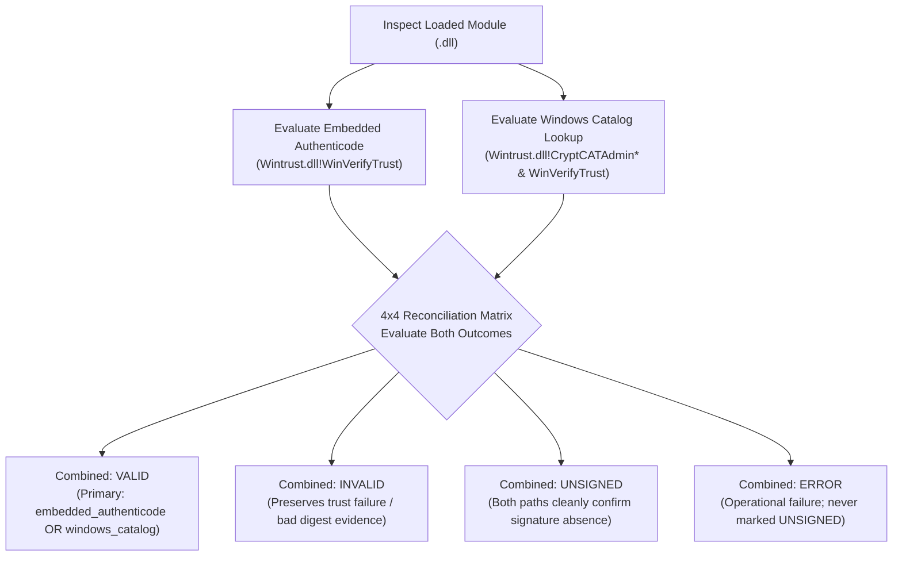
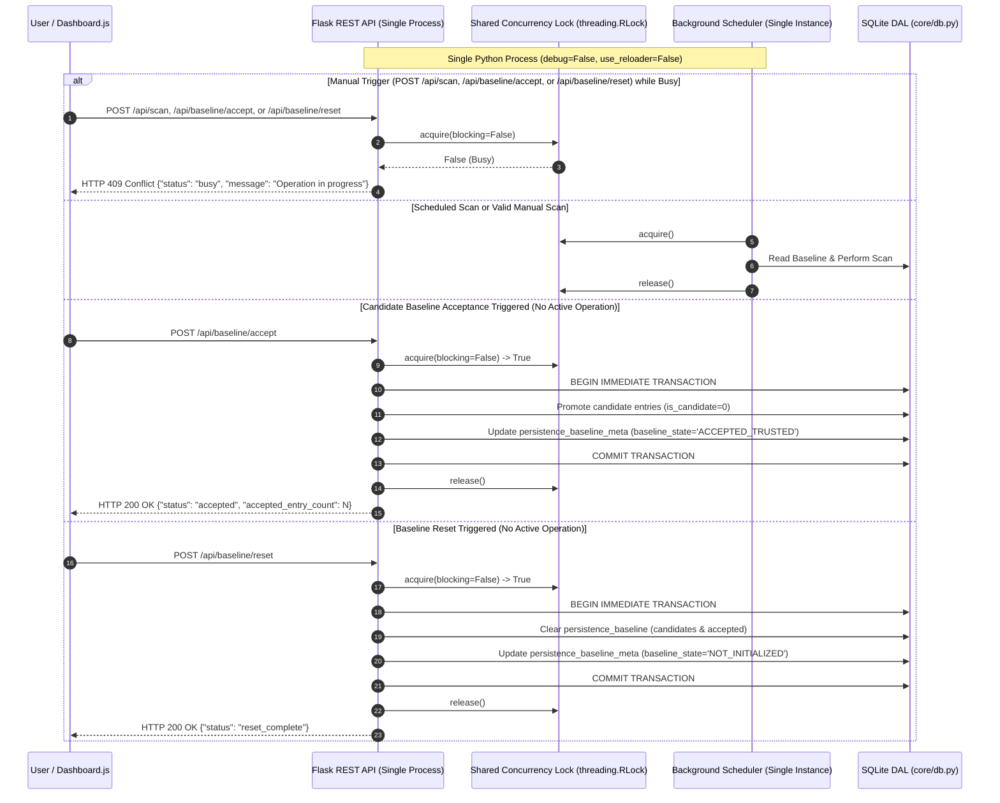
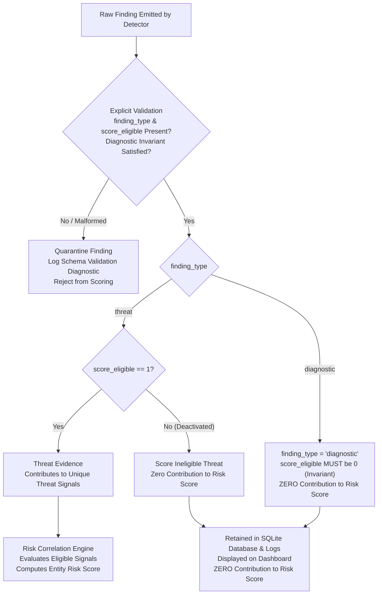
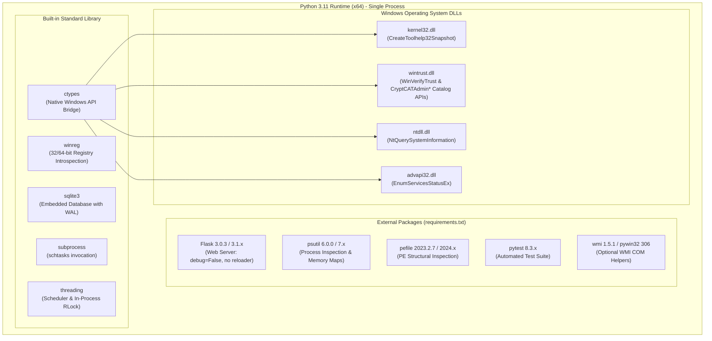
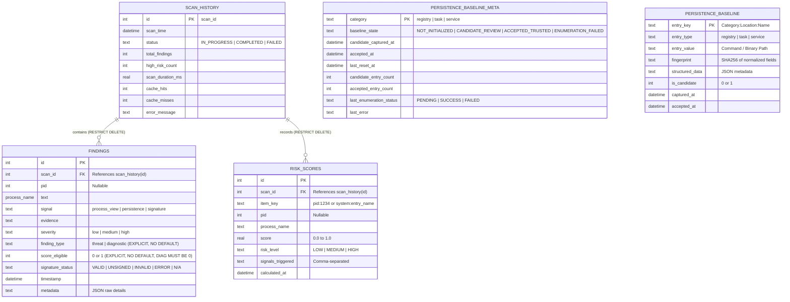
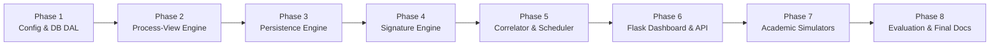
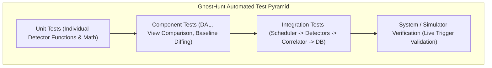

# GhostHunt — Master Development Roadmap & Architectural Specification

**Document Version:** 1.4.3 (Authoritative Technical Specification)  
**Project:** GhostHunt — Multi-Signal User-Mode Rootkit & Stealth Malware Detection System  
**Target Platform:** Windows 10 / Windows 11 (x64)  
**Project Context:** Defensive Security System Implementation  
**Academic Context:** Senior Undergraduate Capstone Project  
**Date:** November 2026  

---

## Table of Contents
1. [Current Project Structure](#1-current-project-structure)
2. [Existing Implementation Status & Code Audit](#2-existing-implementation-status--code-audit)
3. [Proposal vs. Implementation Plan Discrepancy Analysis & Technical Corrections](#3-proposal-vs-implementation-plan-discrepancy-analysis--technical-corrections)
4. [Complete Project Requirements](#4-complete-project-requirements)
5. [Required Modules & Dependency Architecture](#5-required-modules--dependency-architecture)
6. [Database Design (Data Access Layer & Historical Integrity)](#6-database-design-data-access-layer--historical-integrity)
7. [Integration Architecture & Correlation Engine](#7-integration-architecture--correlation-engine)
8. [Recommended Implementation Order (Sequential Phases)](#8-recommended-implementation-order-sequential-phases)
9. [Testing Strategy](#9-testing-strategy)
10. [Potential Technical Problems & Mitigation Strategies](#10-potential-technical-problems--mitigation-strategies)
11. [Final Deliverables Checklist](#11-final-deliverables-checklist)

---

## 1. Current Project Structure

The repository structure currently on disk is laid out as follows:

```text
GhostHunt/
├── .gitignore                                 # Git ignore file (0 bytes)
├── README.md                                  # Project title stub (11 bytes)
├── requirements.txt                           # Python dependencies (86 bytes)
├── config.py                                  # Global constants, thresholds, & cache policy (319 bytes)
├── run.py                                     # Application entry point (single-process runner) (0 bytes)
│
├── core/                                      # Central engine and persistence
│   ├── __init__.py                            # Package init (0 bytes)
│   ├── db.py                                  # SQLite DAL with strict historical retention & fixed baseline (0 bytes)
│   ├── correlator.py                          # Multi-signal risk scoring engine (threat vs diagnostic separation) (0 bytes)
│   └── scheduler.py                           # Single-scan & reset-guarded scheduler & scan_id lifecycle (0 bytes)
│
├── detectors/                                 # Independent signal detection modules
│   ├── __init__.py                            # Package init (0 bytes)
│   ├── process_view.py                        # Signal 1: 3-view process enumerator (Toolhelp32, WMI, NT API) (0 bytes)
│   ├── persistence.py                         # Signal 2: Persistence monitor (Registry, Tasks, Services) (0 bytes)
│   └── signature_check.py                     # Signal 3: Dual-path verifier (4x4 matrix) & metadata cache (0 bytes)
│
├── dashboard/                                 # Web presentation layer (Flask)
│   ├── __init__.py                            # Package init (0 bytes)
│   ├── routes.py                              # Flask route handlers & REST APIs with scan/reset lock (0 bytes)
│   ├── templates/                             # Jinja2 HTML templates
│   │   ├── base.html                          # Base HTML layout & navigation (0 bytes)
│   │   ├── index.html                         # Completed scan risk-ranked process table (0 bytes)
│   │   ├── process_detail.html                # Forensic evidence & diagnostic drill-down (0 bytes)
│   │   └── history.html                       # Scan history & historical scan inspector (0 bytes)
│   └── static/                                # Frontend assets
│       ├── style.css                          # Dark-mode security dashboard styling (0 bytes)
│       └── dashboard.js                       # Asynchronous polling & dynamic updates (0 bytes)
│
├── simulators/                                # Safe academic demonstration harnesses
│   ├── fake_hidden_process.py                 # Demo A: Process-view discrepancy trigger (0 bytes)
│   ├── fake_persistence.py                    # Demo B: Persistence change trigger (0 bytes)
│   └── fake_unsigned_dll/                     # Demo C: Unsigned / unusual path trigger
│       ├── build_dll.py                       # Harmless test DLL generator (0 bytes)
│       └── dummy.dll                          # Target unsigned test DLL (0 bytes)
│
├── tests/                                     # Automated test suites
│   ├── test_process_view.py                   # Tests for 3-view comparison, source failure, & transient filters (0 bytes)
│   ├── test_persistence.py                    # Tests for fixed baseline, persistent deviations, & failure isolation (0 bytes)
│   ├── test_signature_check.py                # Tests for 4x4 signature matrix, error semantics, & cache (0 bytes)
│   └── test_correlator.py                     # Tests for threat vs diagnostic scoring & scan/reset concurrency (0 bytes)
│
└── Docs/                                      # Project documentation & reference papers
    ├── Group12.docx                           # Academic project proposal document
    ├── Group12.pdf                            # Academic project proposal (PDF format)
    ├── GhostHunt — Implementation & Setup Plan.docx # Initial 3-member setup plan
    └── DEVELOPMENT_ROADMAP.md                 # This master specification & roadmap
```

---

## 2. Existing Implementation Status & Code Audit

A complete forensic inspection of every file in the repository was performed:

| File Path | Size | Git Status | Implemented Content & Capabilities |
| :--- | :--- | :--- | :--- |
| `config.py` | 319 B | Committed | Contains 5 basic constants:<br>`SCAN_INTERVAL_SECONDS = 10`<br>`DB_PATH = "ghosthunt.db"`<br>`STARTUP_REGISTRY_PATHS` (HKCU Run & RunOnce)<br>`RISK_WEIGHTS` (0.4, 0.3, 0.3)<br>`HIGH_RISK_THRESHOLD = 0.6` |
| `requirements.txt` | 86 B | Committed | Declares 6 packages:<br>`Flask==3.0.3`, `psutil==6.0.0`, `pefile==2023.2.7`, `pywin32==306`, `wmi==1.5.1`, `pytest==8.3.3` |
| `README.md` | 11 B | Committed | Contains only `# GhostHunt` |
| `.gitignore` | 0 B | Committed | Empty placeholder |
| `run.py` | 0 B | Committed | Empty placeholder |
| `core/db.py` | 0 B | Committed | Empty placeholder |
| `core/correlator.py` | 0 B | Committed | Empty placeholder |
| `core/scheduler.py` | 0 B | Committed | Empty placeholder |
| `detectors/process_view.py` | 0 B | Committed | Empty placeholder |
| `detectors/persistence.py` | 0 B | Committed | Empty placeholder |
| `detectors/signature_check.py` | 0 B | Committed | Empty placeholder |
| `dashboard/routes.py` | 0 B | Committed | Empty placeholder |
| `dashboard/templates/*.html` | 0 B | Committed | Empty placeholders (4 files) |
| `dashboard/static/*` | 0 B | Committed | Empty placeholders (`style.css`, `dashboard.js`) |
| `simulators/*` | 0 B | Committed | Empty placeholders (4 files) |
| `tests/*.py` | 0 B | Committed | Empty placeholders (4 test suites) |
| `Docs/Group12.docx/.pdf` | ~2.1 MB | Committed | Complete academic proposal |
| `Docs/GhostHunt — Implementation & Setup Plan.docx` | 10.5 KB | Committed | Setup & initial plan document |

### Summary of Audit
- **Business Logic Implemented:** 0% (the core, detectors, dashboard, simulators, and tests are currently empty placeholders).
- **Configuration & Scaffolding:** 10% (`config.py` has baseline weights; directory hierarchy is initialized).
- **Documentation:** Academic proposal and setup plan are present in `Docs/`.
- **Unified Engineering Scope:** All components across detection, database, scheduler, presentation, and testing are integrated within a single unified codebase.
- **Source Code Integrity:** No source code or placeholder files are modified during this specification phase.

---

## 3. Proposal vs. Implementation Plan Discrepancy Analysis & Technical Corrections

### 3.1 Three Identifiable Process Enumeration Paths & Defensible Guarantees

| Process Enumeration Path | Implementation Mechanism | Technical Scope & Distinction |
| :--- | :--- | :--- |
| **Path 1: Win32 Process Snapshot** | `kernel32.dll!CreateToolhelp32Snapshot`, `Process32First`, `Process32Next` via `ctypes` | The standard Win32 process snapshot API. Enumerates running processes via the Win32 subsystem. Note: `psutil` is used separately for process metadata (command line, memory maps, exe path), but `psutil` is **not** labeled as the implementation of Toolhelp32. |
| **Path 2: WMI / CIM Interface** | `Win32_Process` via WMI COM / CIM | Queries Windows Management Instrumentation (`winmgmt` service) via RPC/COM, providing an out-of-process management view. |
| **Path 3: Native NT System Call** | `ntdll.dll!NtQuerySystemInformation(SystemProcessInformation = 5)` via `ctypes` | Directly queries the Native NT API in `ntdll.dll`, issuing system calls that bypass high-level Win32 wrappers (`kernel32.dll`, `advapi32.dll`). |

#### Accurate Technical Boundary: Native NT Calls & User-Mode Hooking
- Calling `NtQuerySystemInformation` provides a separate, lower-level enumeration path from high-level Win32 APIs, **but it does not guarantee bypassing user-mode hooks**. `ntdll.dll` resides entirely inside user-mode virtual address space and can itself be hooked (e.g., inline function hooking of the `NtQuerySystemInformation` prologue or Import Address Table patching) by user-mode malware.
- Furthermore, the three enumeration paths are **not fully independent**: they all query common underlying Windows executive kernel data structures (`EPROCESS` blocks in kernel memory).
- Consequently, discrepancies between views represent **anomalous behavioral evidence requiring forensic investigation**, not conclusive proof of a rootkit.

#### Handling Source Failures & Preventing False Discrepancies
- **Explicit Source Status:** Every enumeration source returns a structured response:
  $$\text{SourceResult} = \{ \text{"success"}: \text{bool}, \text{"processes"}: \text{dict}[\text{int}, \text{str}], \text{"error"}: \text{Optional}[\text{str}] \}$$
- **No Empty-List Spoofing:** A failed or timed-out source is **never** treated as an empty process list (`{}`).
- **Failure Exclusion:** A process is never marked "missing" from a source that failed to execute. Comparisons evaluate only successfully obtained sources.
- **Minimum Source Quorum:** If fewer than two sources succeed during a scan cycle, cross-view comparison is aborted for that cycle; an operational diagnostic finding is logged, but zero false process discrepancies are emitted.
- **Two-Pass Confirmation:** Any process flagged as a discrepancy in Pass 1 is re-queried across all available sources after a 50 ms delay. A discrepancy is discarded as transient **only when there is positive evidence that the process exited or the discrepancy resolved**; source failure alone is never accepted as a reason to dismiss a discrepancy.

---

### 3.2 Controlled Baseline Capture, Acceptance Workflow & Fixed Reference Baseline Semantics

#### Fixed Reference Baseline Principles
GhostHunt operates on the principle of an **accepted, fixed reference baseline**, reflecting intentional defensive security engineering and eliminating architectural contradictions between automatic capture and human verification:
1. **Candidate Capture:** The first successful enumeration of each persistence category captures a candidate inventory snapshot. This candidate snapshot is persisted in the database with status `CANDIDATE_REVIEW`.
2. **Explicit Operator Acceptance:** A candidate baseline remains **untrusted** and **inactive for deviation diffing** until the operator reviews the discovered inventory and explicitly triggers acceptance (via `POST /api/baseline/accept` or dashboard action). Upon acceptance, metadata transitions to `ACCEPTED_TRUSTED`.
3. **Fixed Reference Diffing:** Ordinary scans compare current system observations strictly against the `ACCEPTED_TRUSTED` reference baseline. Ordinary scans **never silently advance, update, or replace the accepted reference baseline**.
4. **Intentional Forensic Continuity:** Any unauthorized modification that remains present in the system will continue to be flagged as a deviation across subsequent scans until the operator remediates the system or explicitly triggers an authorized baseline reset. This is deliberate forensic behavior, not a repeated-event defect.
5. **Deviation Definitions:**
   - **`added`**: An entry currently observed on the system that is absent from the accepted reference baseline.
   - **`modified`**: An entry currently observed whose normalized fingerprint (SHA256 of configuration attributes) differs from the corresponding accepted reference baseline entry.
   - **`removed`**: An entry present in the accepted reference baseline that is absent from a successfully enumerated current category.
6. **Suppression & Gated Diffing:**
   - If a category is in `NOT_INITIALIZED` or `CANDIDATE_REVIEW`, baseline deviation detection is suppressed. An operational diagnostic finding (`score_eligible = 0`) is logged informing the operator that baseline review/acceptance is required.
   - If an accepted category suffers an enumeration failure (`ENUMERATION_FAILED`), diffing is skipped for that cycle, an operational diagnostic finding is logged, and **zero false `removed` findings are produced**.

```mermaid
stateDiagram-v2
    [*] --> NOT_INITIALIZED: System Start / Post-Reset
    
    NOT_INITIALIZED --> ENUMERATION_FAILED: First Scan Enumeration Fails (Diagnostic Logged; No Findings)
    ENUMERATION_FAILED --> NOT_INITIALIZED: Subsequent Scan Retry
    
    NOT_INITIALIZED --> CANDIDATE_REVIEW: First Successful Enumeration (Candidate Inventory Captured; Diagnostic Logged; 0 Threat Findings)
    
    CANDIDATE_REVIEW --> CANDIDATE_REVIEW: Subsequent Scan Before Acceptance (Diffing Suppressed; Diagnostic Logged)
    CANDIDATE_REVIEW --> CANDIDATE_REVIEW: Category Enumeration Fails (Existing Candidate Preserved; Diagnostic Logged)
    
    CANDIDATE_REVIEW --> ACCEPTED_TRUSTED: Explicit Operator Acceptance (POST /api/baseline/accept)
    
    ACCEPTED_TRUSTED --> ACCEPTED_TRUSTED: Subsequent Scan Clean (No Deviations Observed)
    ACCEPTED_TRUSTED --> ACCEPTED_TRUSTED: Subsequent Scan with Drift (Deviations Flagged: Added/Modified/Removed Persist)
    ACCEPTED_TRUSTED --> ENUMERATION_FAILED: Category Enumeration Fails (Diffing Skipped; Zero False Removed; Diagnostic Logged)
    ENUMERATION_FAILED --> ACCEPTED_TRUSTED: Category Enumeration Recovers (Resumes Normal Diffing vs Accepted Baseline)
    
    ACCEPTED_TRUSTED --> NOT_INITIALIZED: Explicit Manual Reset (POST /api/baseline/reset; Atomic Transaction)
    CANDIDATE_REVIEW --> NOT_INITIALIZED: Explicit Manual Reset (POST /api/baseline/reset; Atomic Transaction)
```



#### Trust Assumptions & Pre-Existing Persistence (Limitation Disclosure)
- **Pre-Existing Persistence in Candidate Snapshot:** The initial successful enumeration captures whatever autoruns, tasks, and services currently exist on the operating system. If an unauthorized autorun or stealth persistence entry was installed **prior to GhostHunt's first run**, it will be incorporated into the initial candidate baseline.
- **Drift Detection vs. Historical Root Cause:** GhostHunt's persistence engine is designed to detect *subsequent unauthorized baseline drift relative to an accepted reference baseline*, not to retroactively determine if an existing pre-installed item was placed maliciously in the past. It will **not** flag a pre-existing entry as newly added merely because it was present during initial candidate capture.
- **Controlled Human-in-the-Loop Security Boundary:** To prevent blind trust in pre-existing compromises, GhostHunt enforces explicit operator acceptance:
  1. **Candidate Review Requirement:** Captured candidate entries are displayed in the dashboard under a distinct "Candidate Baseline Review" panel with full forensic attributes (registry hive/path/value, task command/triggers, service binary/start type/account).
  2. **Operator Audit:** The operator must inspect the candidate inventory and verify its legitimacy before clicking "Accept Baseline".
  3. **Establish Baseline on Known-Clean Systems:** For maximum assurance in production or forensic evaluation, initial baselines should be captured on freshly installed, verified, or known-clean reference images.
  4. **Reset as a High-Trust Action:** Triggering an authorized reset clears both candidate and accepted baselines, requiring a new candidate capture and explicit re-acceptance cycle.

#### Per-Category State Architecture
The database tracks this state independently for each category in `persistence_baseline_meta` with rows for `'registry'`, `'task'`, and `'service'`:
- **State 1: `NOT_INITIALIZED` (`baseline_state = 'NOT_INITIALIZED'`):** System start or post-reset. No baseline records exist. Baseline diffing is suppressed; zero threat findings are emitted.
- **State 2: `CANDIDATE_REVIEW` (`baseline_state = 'CANDIDATE_REVIEW'`):** A candidate inventory has been successfully captured and stored (`is_candidate = 1` in `persistence_baseline`). Diffing is suppressed. A diagnostic finding (`score_eligible = 0`) is logged on each scan until the operator accepts the baseline.
- **State 3: `ACCEPTED_TRUSTED` (`baseline_state = 'ACCEPTED_TRUSTED'`):** The operator explicitly accepted the candidate baseline (`is_candidate = 0`, `accepted_at` recorded). Ordinary scans compare current observations against these reference records. Deviations produce threat findings (`score_eligible = 1`).
- **State 4: `ENUMERATION_FAILED` (`baseline_state = 'ENUMERATION_FAILED'` or `last_enumeration_status = 'FAILED'`):** Category enumeration failed or timed out. If previously `ACCEPTED_TRUSTED`, diffing is skipped for this cycle, preventing false `removed` findings, and an operational diagnostic is logged.

#### Partial First-Scan & Acceptance Workflow Walkthrough
1. **Scan 1 (Partial Failure):** Registry succeeds (12 entries), Scheduled Tasks fails (timeout/access denied), Services succeeds (85 entries).
   - Registry is saved as candidate: `baseline_state = 'CANDIDATE_REVIEW', candidate_entry_count = 12`. Operational diagnostic logged: awaiting acceptance.
   - Services is saved as candidate: `baseline_state = 'CANDIDATE_REVIEW', candidate_entry_count = 85`. Operational diagnostic logged: awaiting acceptance.
   - Scheduled Tasks remains `NOT_INITIALIZED` (or `last_enumeration_status = 'FAILED'`). Operational diagnostic logged: enumeration error.
   - **Zero threat findings emitted** across all categories.
2. **Operator Reviews & Accepts Registry and Services:**
   - Operator audits candidate tables via dashboard, determines entries are legitimate OS/application autoruns, and submits `POST /api/baseline/accept`.
   - Registry and Services transition to `ACCEPTED_TRUSTED`.
   - Tasks remains `NOT_INITIALIZED`.
3. **Scan 2 (Tasks Recovers):** Scheduled Tasks now succeeds (40 existing tasks found).
   - Tasks is captured as candidate: `baseline_state = 'CANDIDATE_REVIEW', candidate_entry_count = 40`. Diagnostic logged: awaiting acceptance.
   - Registry and Services diff normally against their `ACCEPTED_TRUSTED` baselines (zero deviations if unchanged).
   - **Zero threat findings emitted** for the 40 pre-existing tasks.
4. **Operator Accepts Tasks:**
   - Operator audits task list and submits `POST /api/baseline/accept` for tasks.
   - Tasks transitions to `ACCEPTED_TRUSTED` (`accepted_entry_count = 40`).
5. **Scan 3 (All Accepted):** All three categories are in `ACCEPTED_TRUSTED`. Ordinary scans diff strictly against accepted entries. Any subsequent unauthorized autorun is immediately flagged as `added` (`score_eligible = 1`).

#### Candidate Acceptance & Atomic Reset Workflows
- **Baseline Acceptance (`POST /api/baseline/accept`):**
  - Synchronized via `threading.RLock()` (returns HTTP 409 Conflict if an operation is active).
  - Promotes candidate entries (`UPDATE persistence_baseline SET is_candidate = 0, accepted_at = CURRENT_TIMESTAMP WHERE is_candidate = 1`) and updates metadata (`baseline_state = 'ACCEPTED_TRUSTED'`, `accepted_at = CURRENT_TIMESTAMP`, `accepted_entry_count = candidate_entry_count`) inside an isolated atomic database transaction (`BEGIN IMMEDIATE TRANSACTION` $\dots$ `COMMIT`).
- **Baseline Reset (`POST /api/baseline/reset`):**
  - Synchronized via `threading.RLock()` (returns HTTP 409 Conflict if an operation is active).
  - Wipes all entries from `persistence_baseline` (both candidate and accepted) and resets metadata in `persistence_baseline_meta` (`baseline_state = 'NOT_INITIALIZED'`, `candidate_entry_count = 0`, `accepted_entry_count = 0`, `candidate_captured_at = NULL`, `accepted_at = NULL`, `last_reset_at = CURRENT_TIMESTAMP`) inside an isolated atomic transaction.
  - The subsequent scan begins a fresh candidate capture cycle.

---

### 3.3 Independent Dual-Path Signature Verification & Complete 4×4 Reconciliation Matrix

#### Windows API Mapping: Wintrust.dll
- **Catalog Administration Exported by `Wintrust.dll`:** Catalog administration functions (`CryptCATAdminAcquireContext`, `CryptCATAdminCalcHashFromFileHandle`, `CryptCATAdminEnumCatalogFromHash`, `CryptCATAdminReleaseCatalogContext`, `CryptCATAdminReleaseContext`) are exported by **`Wintrust.dll`**, **not** `Crypt32.dll`.
- **Trust Verification Exported by `Wintrust.dll`:** `WinVerifyTrust` is also exported by **`Wintrust.dll`**.
- **Implementation Verification:** All exported functions, ctypes structures, constants, and calling conventions (`stdcall` / `WINAPI`) must be verified against official Windows SDK headers (`wintrust.h`, `mscat.h`) during implementation. Actual return codes and trust-provider behaviors must be verified against the Windows SDK and controlled test binaries.



#### Complete 4×4 Signature Reconciliation Matrix
The system evaluates all 16 combinations of Embedded and Catalog verification outcomes deterministically. Both individual statuses, HRESULT error codes, catalog filenames, and verification methods are permanently preserved in metadata:

| Embedded Outcome | Catalog Outcome | Combined Classification | Primary Method | Forensic Rationale & Metadata Preservation Rules |
| :--- | :--- | :--- | :--- | :--- |
| **`VALID`** | **`VALID`** | **`VALID`** | `embedded_authenticode` | Both paths independently confirm valid cryptographic trust. Dual confirmation preserved in metadata. |
| **`VALID`** | **`UNSIGNED`** | **`VALID`** | `embedded_authenticode` | Valid embedded signature. Catalog membership is not required for binaries carrying embedded signatures. |
| **`VALID`** | **`INVALID`** | **`VALID`** | `embedded_authenticode` | Embedded signature is cryptographically valid. Catalog invalidity (e.g. stale catalog) is recorded in metadata for forensic inspection. |
| **`VALID`** | **`ERROR`** | **`VALID`** | `embedded_authenticode` | Rule 1: A valid embedded signature produces combined `VALID`, even if catalog verification fails operationally. Operational error recorded in metadata. |
| **`UNSIGNED`** | **`VALID`** | **`VALID`** | `windows_catalog` | Rule 2: Clean catalog-signed OS component without embedded signature. Both results preserved in metadata. |
| **`UNSIGNED`** | **`UNSIGNED`** | **`UNSIGNED`** | `none_found` | Rule 3: Clean absence of both signature types confirms file is `UNSIGNED`. |
| **`UNSIGNED`** | **`INVALID`** | **`INVALID`** | `windows_catalog` | Rule 7: No embedded signature, and matching catalog failed trust, was revoked, or expired. |
| **`UNSIGNED`** | **`ERROR`** | **`ERROR`** | `catalog_lookup_error` | Rules 4 & 6: Operational failure must never be treated as clean absence. If catalog lookup reports `ERROR` and embedded is `UNSIGNED`, the status is inconclusive $\rightarrow$ `ERROR`. |
| **`INVALID`** | **`VALID`** | **`VALID`** | `windows_catalog` | Rule 2: Valid catalog signature produces combined `VALID` (e.g. updated Windows binary with expired embedded cert or updated digest validated by current OS catalog). Dual metadata preserved. |
| **`INVALID`** | **`UNSIGNED`** | **`INVALID`** | `embedded_authenticode` | Rule 7: Embedded signature failed trust (tampered, expired, or `TRUST_E_BAD_DIGEST`) and no catalog validates it. |
| **`INVALID`** | **`INVALID`** | **`INVALID`** | `dual_invalid` | Both paths report invalid signatures or revoked/untrusted certificates. |
| **`INVALID`** | **`ERROR`** | **`INVALID`** | `embedded_authenticode` | Rule 5: One path reports known invalid signature while other reports operational error; preserves known invalid evidence without pretending catalog completed. Catalog error recorded in metadata. |
| **`ERROR`** | **`VALID`** | **`VALID`** | `windows_catalog` | Rule 2: Embedded PE directory unreadable or malformed, but file hash catalog lookup independently validates trust. Embedded error preserved in metadata. |
| **`ERROR`** | **`UNSIGNED`** | **`ERROR`** | `embedded_error` | Rule 6: Inconclusive result. Because embedded verification suffered an operational error, clean absence cannot be confirmed. Classified as `ERROR`, not `UNSIGNED`. |
| **`ERROR`** | **`INVALID`** | **`INVALID`** | `windows_catalog` | Rule 5: Known invalid catalog evidence preserved despite embedded operational error. |
| **`ERROR`** | **`ERROR`** | **`ERROR`** | `dual_error` | Both verification paths suffered operational failures (file locked, inaccessible, or I/O error). |

---

### 3.4 Verification Cache: Integrity versus Performance

#### The Trade-Off Analysis
- **Full File Rehashing:** Calculating SHA256 across all loaded modules on every 10-second scan would read hundreds of megabytes of binaries continuously from disk, creating excessive disk queue lengths and defeating evaluation targets.
- **Metadata-Only Cache Validation:** Fast, but cannot guarantee detecting an attacker who maliciously stomped timestamps while preserving identical file size.

#### Selected Defensible Policy for GhostHunt
GhostHunt adopts a **hybrid metadata-keyed cache with safe invalidation and periodic forced revalidation**:

1. **Cache Record Fields:**
   $$\text{CacheEntry} = \{ \text{canonical\_path}, \text{file\_size}, \text{mtime\_ns}, \text{file\_digest}, \text{verification\_result}, \text{cached\_at}, \text{last\_verified\_at}, \text{hit\_count} \}$$
2. **Lookup Validation (Fast Path):**
   - On each scan, check:
     1. Canonical path (`os.path.realpath`).
     2. Current file size (`st_size`).
     3. High-precision last-write timestamp (`st_mtime_ns`).
   - If canonical path matches, and current `st_size` and `st_mtime_ns` match cached values: **Cache hit is accepted without reading binary bytes or recalculating digest**.
3. **Cache Miss / Invalidation (Slow Path):**
   - If path is not cached, or if `st_size` or `st_mtime_ns` differs:
     1. Recalculate SHA256 digest from disk.
     2. Perform full dual-path signature verification.
     3. Update cache record.
4. **Safety Enhancements:**
   - **Periodic Forced Revalidation:** Every cache record has a maximum TTL (e.g. 1,800 seconds / 30 minutes). After TTL expiration, the cache entry forces a re-verification on its next encounter regardless of metadata match.
   - **In-Flight Change Detection:** If file size or timestamp changes between initial memory-map enumeration and disk verification, the result is rejected and re-queued.
   - **Telemetry:** Cache hits, misses, forced revalidations, and verification errors are logged in `scan_history`.

---

### 3.5 Application Process Model & Scan/Reset/Accept Concurrency

#### Application Process Model
To guarantee synchronization and prevent split-brain states, the GhostHunt runtime is explicitly specified as:
1. **Single Application Process:** GhostHunt executes within a **single Python OS process** launched via `python run.py`.
2. **Single Background Scheduler:** Exactly one background scheduler instance (`threading.Thread`) runs within this process.
3. **Disabled Flask Reloader & Debug Mode:** Flask debug mode is explicitly disabled (`debug=False`), and Flask's automatic reloader is disabled (`use_reloader=False`). This prevents the Werkzeug reloader from spawning a second child process that would launch a duplicate scheduler and competing locks.
4. **Shared In-Process Synchronization Lock:** All scheduled scans, manual scan API requests (`POST /api/scan`), candidate baseline acceptance (`POST /api/baseline/accept`), and baseline resets (`POST /api/baseline/reset`) synchronize using the same shared `threading.RLock()` instance.
5. **Non-Blocking Lock Acquisition with HTTP 409:** Manual API operations attempt non-blocking lock acquisition (`acquire(blocking=False)`). If a scan, acceptance, or reset is active, the API immediately returns **HTTP 409 Conflict** with a descriptive busy payload: `{"status": "busy", "message": "An engine operation is already in progress"}`.
6. **In-Process Boundary & Future Scaling:** `threading.RLock()` is strictly an in-process mechanism. If multi-process WSGI hosting (e.g. multi-worker Gunicorn/Waitress) is introduced in a future release, cross-process coordination must be upgraded to a named Windows kernel mutex (`CreateMutexW` via `win32event`) or database-backed advisory locks.



---

### 3.6 Strict Separation of Threat Evidence from Operational Diagnostics & Fail-Safe Classification Invariant

A foundational architectural requirement in GhostHunt is the **strict, fail-safe separation between threat evidence and operational diagnostics**:



#### Fail-Safe Classification Rules & Structural Invariants
To prevent accidental misclassification of operational diagnostics as score-eligible threats (e.g. through forgotten fields or silent defaults):

1. **No Silent Defaults:**
   - The database schema and code contracts **strictly prohibit default values** that could classify unclassified findings as threats.
   - The DDL specifies `finding_type TEXT NOT NULL` and `score_eligible INTEGER NOT NULL` with **no default clauses** (`DEFAULT 'threat'` and `DEFAULT 1` are permanently removed).
   - Every emitting detector function must provide explicit values for both `finding_type` and `score_eligible`.

2. **Mandatory Invariant:**
   $$\text{finding\_type} = \text{'diagnostic'} \implies \text{score\_eligible} = 0$$
   - An operational diagnostic is **mathematically barred** from having `score_eligible = 1`.
   - A threat finding (`finding_type = 'threat'`) may have `score_eligible = 1` (normal threat signal) or `score_eligible = 0` (if explicitly deactivated or informational), but a diagnostic must never be score-eligible.

3. **Multi-Layer Defensive Enforcement:**
   - **Layer 1: Database DDL CHECK Constraint:**
     `CHECK (((finding_type = 'diagnostic') AND (score_eligible = 0)) OR ((finding_type = 'threat') AND (score_eligible IN (0, 1))))`
   - **Layer 2: Data Access Layer Pre-Insert Validation (`core/db.py`):**
     Before writing to SQLite, `validate_finding()` checks that both keys are present and conform to the invariant. Violations raise an immediate exception.
   - **Layer 3: Risk Correlation Engine Guard (`core/correlator.py`):**
     The correlator explicitly validates findings prior to scoring. It strictly filters for:
     `finding['finding_type'] == 'threat' and finding['score_eligible'] is True (or 1)`
     Any finding failing this test or violating the invariant is rejected from the risk score calculation.

4. **Taxonomy of Finding Types:**
   - **Threat Evidence (`finding_type = 'threat'`, `score_eligible = 1`):**
     - Cross-view process discrepancy confirmed by two-pass check.
     - Verified persistence deviation (`added`, `modified`, or `removed` entry relative to the `ACCEPTED_TRUSTED` reference baseline).
     - Loaded module with combined signature status `UNSIGNED` or `INVALID` loaded from an unusual/suspicious directory.
   - **Operational Diagnostics (`finding_type = 'diagnostic'`, `score_eligible = 0`):**
     - Access-denied errors on protected system processes (`csrss.exe`, `audiodg.exe`).
     - WMI query timeout or process enumeration source failure.
     - Persistence category enumeration failure (e.g. task scheduler query failure).
     - Candidate baseline capture notification (awaiting operator acceptance).
     - Signature verification operational failures (`signature_status == 'ERROR'`: locked file, I/O error, catalog lookup failure).
     - Inconclusive signature results (`ERROR` + `UNSIGNED`).
     - **Guaranteed Isolation:** Operational diagnostics alone **contribute 0.0 to entity risk scores**. They never trigger a threat signal and never escalate an entity's risk category.
     - **Forensic Visibility:** All diagnostics remain stored in SQLite and are rendered in a dedicated diagnostic section of the web dashboard for operator auditing.

---

## 4. Complete Project Requirements

### 4.1 Functional Requirements (FR)

- **FR-1: Cross-View Process Enumeration Engine (`detectors/process_view.py`)**
  - FR-1.1: Query running processes via Win32 Toolhelp32 snapshot (`CreateToolhelp32Snapshot`, `Process32First/Next` via `ctypes.windll.kernel32`).
  - FR-1.2: Query running processes via WMI (`Win32_Process`).
  - FR-1.3: Query running processes via Native NT API (`ntdll.dll!NtQuerySystemInformation(SystemProcessInformation = 5)`).
  - FR-1.4: Capture explicit success/failure status and error details for every source independently.
  - FR-1.5: Compare only successfully obtained sources. Never treat a failed source as an empty list. Exclude failed sources from missing-process comparisons.
  - FR-1.6: Execute two-pass confirmation with a 50 ms micro-delay. Discard discrepancies as transient only if positive evidence shows the process exited or the discrepancy resolved.
  - FR-1.7: Log access-denied errors and source failures as operational diagnostics (`finding_type = 'diagnostic'`, `score_eligible = 0`). Only confirmed discrepancies are emitted as threat findings (`finding_type = 'threat'`, `score_eligible = 1`). Every finding must explicitly provide both fields.

- **FR-2: Complete Persistence Monitoring Engine (`detectors/persistence.py`)**
  - FR-2.1: Establish per-category candidate baselines across registry entries (`HKCU` and `HKLM` Run/RunOnce in 32-bit and 64-bit views), scheduled tasks (`schtasks.exe`), and installed Windows services (`advapi32.dll!EnumServicesStatusEx` / `Win32_Service`).
  - FR-2.2: Track explicit per-category baseline states (`NOT_INITIALIZED`, `CANDIDATE_REVIEW`, `ACCEPTED_TRUSTED`, `ENUMERATION_FAILED`) in `persistence_baseline_meta`. First successful enumeration captures inventory into candidate records (`is_candidate = 1`), transitions to `CANDIDATE_REVIEW`, emits zero threat deviations, and emits an operational diagnostic (`finding_type = 'diagnostic'`, `score_eligible = 0`) awaiting operator review. Pre-existing persistence present at candidate capture is incorporated into candidate records and not retroactively flagged as added.
  - FR-2.3: In subsequent scans, isolate category failures: if a category fails, skip diffing for that category, emit an operational diagnostic finding (`finding_type = 'diagnostic'`, `score_eligible = 0`), and never emit false `removed` findings.
  - FR-2.4: When an uninitialized category succeeds for the first time during a later scan, capture its candidate baseline cleanly without emitting "added" findings, entering `CANDIDATE_REVIEW`.
  - FR-2.5: Detect persistent deviations (`added`, `modified`, or `removed` entries) across successfully enumerated categories strictly against `ACCEPTED_TRUSTED` reference baseline records. If a category is in `NOT_INITIALIZED` or `CANDIDATE_REVIEW`, deviation detection is suppressed. Persistent deviations are emitted as threat findings (`finding_type = 'threat'`, `score_eligible = 1`) and continue to be flagged until remediated or reset.
  - FR-2.6: Provide an explicit candidate baseline acceptance API endpoint (`POST /api/baseline/accept`) and dashboard action, promoting candidate entries to `ACCEPTED_TRUSTED` inside an atomic transaction guarded by the concurrency lock.
  - FR-2.7: Provide an atomic baseline reset API endpoint (`POST /api/baseline/reset`) guarded by the shared synchronization lock that wipes candidate and accepted baseline records and resets metadata to `NOT_INITIALIZED` inside an isolated database transaction. Ordinary scans are strictly read-only.

- **FR-3: DLL Signature & Suspicious-Path Verification Engine (`detectors/signature_check.py`)**
  - FR-3.1: Enumerate loaded modules for running processes via `psutil.Process.memory_maps()`.
  - FR-3.2: Inspect PE structures and extract `IMAGE_DIRECTORY_ENTRY_SECURITY` using `pefile`.
  - FR-3.3: Implement two independent signature validation paths:
    - Path 1: Embedded Authenticode verification via `Wintrust.dll!WinVerifyTrust` (`WINTRUST_FILE_INFO`).
    - Path 2: Windows Catalog signature verification via `Wintrust.dll!CryptCATAdmin*` and `WinVerifyTrust` (`WINTRUST_CATALOG_INFO`).
  - FR-3.4: Classify every module into one of four distinct states: **`VALID`**, **`UNSIGNED`**, **`INVALID`**, or **`ERROR`** using the complete 4×4 reconciliation matrix. Modules resulting in `ERROR` are emitted as operational diagnostics (`finding_type = 'diagnostic'`, `score_eligible = 0`); modules resulting in `UNSIGNED` or `INVALID` in suspicious paths are emitted as threat findings (`finding_type = 'threat'`, `score_eligible = 1`). Explicit classification fields are required without defaults.
  - FR-3.5: Evaluate module paths against system directory whitelists (`System32`, `SysWOW64`, `Program Files`, `WinSxS`). Flag modules loaded from suspicious paths (`%TEMP%`, `%APPDATA%`, `Downloads`, `Desktop`, root paths).
  - FR-3.6: Implement a hybrid verification cache keyed by canonical path, file size, and last-write timestamp, with SHA256 digest verification on miss/invalidation and periodic TTL revalidation. Record cache telemetry.
  - FR-3.7: Treat unsigned status and atypical load paths as behavioral risk indicators, preserving exact error codes, verification methods, and paths.

- **FR-4: Multi-Signal Risk Correlation Engine (`core/correlator.py`)**
  - FR-4.1: Correlate findings tied to a specific `scan_id`. Support active PIDs and dormant persistence entries (`system:<category>:<name>`).
  - FR-4.2: Enforce fail-safe separation of threat evidence from operational diagnostics. Findings must be validated before correlation: findings with `finding_type = 'diagnostic'` MUST have `score_eligible = 0`. Only findings where `finding_type == 'threat' AND score_eligible is True` are evaluated for risk scoring. Any finding violating classification invariants is quarantined and rejected. Operational diagnostics alone contribute 0.0 to risk score.
  - FR-4.3: Enforce strict signal deduplication across eligible threat findings: multiple threat findings under the same signal category contribute to evidence but increment the category weight only once.
  - FR-4.4: Calculate explainable weighted risk score:
    $$\text{ThreatSignalsTriggered} = \text{Unique}\left(\{ f[\text{'signal'}] \mid f \in \text{EntityFindings} \land f[\text{'score\_eligible'}] == \text{True} \land f[\text{'finding\_type'}] == \text{'threat'} \}\right)$$
    $$\text{Risk Score} = \min\left(1.0, \sum_{s \in \text{ThreatSignalsTriggered}} W_s\right)$$
    Default weights: $W_{\text{process\_view}} = 0.40$, $W_{\text{persistence}} = 0.30$, $W_{\text{signature}} = 0.30$.
  - FR-4.5: Classify risk levels: **LOW** ($< 0.40$), **MEDIUM** ($0.40 - 0.59$), **HIGH** ($\ge 0.60$).
  - FR-4.6: Preserve all forensic evidence text strings and error details for complete explainability.

- **FR-5: Background Scan Scheduler & Data Access Layer (`core/scheduler.py`, `core/db.py`)**
  - FR-5.1: Manage discrete scan lifecycles, generating a sequential `scan_id` for every cycle (`IN_PROGRESS` $\rightarrow$ `COMPLETED` or `FAILED`).
  - FR-5.2: Enforce a thread-safe single-scan execution and operation guard (`threading.RLock()`) within a single Python process, preventing overlapping periodic scans, manual scans (`POST /api/scan`), baseline acceptance (`POST /api/baseline/accept`), and baseline resets (`POST /api/baseline/reset`).
  - FR-5.3: Dispatch automated scans based on the configured `SCAN_INTERVAL_SECONDS` (default: 10s) scheduling interval.
  - FR-5.4: Persist all findings, risk scores, baselines, and scan execution logs in SQLite with strict historical retention.

- **FR-6: Presentation Layer & Web Dashboard (`dashboard/`)**
  - FR-6.1: Modern Flask web interface with responsive dark-mode styling, deployed with `debug=False` and `use_reloader=False`.
  - FR-6.2: Main Dashboard (`/`): Display the **latest completed scan** (`status = 'COMPLETED'`), with summary metric cards, risk distribution chart, risk-ranked entity table, and an interactive Candidate Baseline Review & Acceptance panel when categories are in `CANDIDATE_REVIEW`.
  - FR-6.3: Process Detail View (`/process/<pid>`): Display forensic evidence cards for threat findings and a distinct section for operational diagnostics, signature verification states, module paths, and persistence associations.
  - FR-6.4: System Findings View (`/system-findings`): Display dormant persistence entries (registry, tasks, services) for the latest completed scan.
  - FR-6.5: Historical Scan Log (`/history`): Display timeline of all historical scans with drill-down capability into any completed or failed `scan_id`.
  - FR-6.6: REST API: Asynchronous endpoints for current scores (`GET /api/scores`), manual scan trigger (`POST /api/scan`, returning 409 if busy), candidate baseline acceptance (`POST /api/baseline/accept`, returning 409 if busy), and baseline reset (`POST /api/baseline/reset`, returning 409 if busy).

- **FR-7: Safe Demonstration Simulators (`simulators/`)**
  - FR-7.1: `fake_hidden_process.py`: Safe demonstration of process-view discrepancy without modifying OS structures or injecting hooks.
  - FR-7.2: `fake_persistence.py`: Safe registration of test autorun entries across test registry keys or scheduled tasks with automatic cleanup.
  - FR-7.3: `fake_unsigned_dll/`: Generation and loading of a harmless unsigned test DLL from an atypical directory.

- **FR-8: Automated Testing & Verification (`tests/`)**
  - FR-8.1: Unit test coverage across all detectors, database DAL, correlator, scheduler, and API endpoints.
  - FR-8.2: Integration test verifying end-to-end multi-signal correlation, threat vs diagnostic scoring separation, scan/reset concurrency guards, persistent deviation retention, and historical records.

---

### 4.2 Non-Functional & Safety Requirements (NFR)

- **NFR-1 (Defensive Safety Guarantee):** Strictly defensive academic project. No real rootkit code, no user-mode or kernel-mode API hooking, no kernel-mode drivers, no arbitrary code injection into unrelated processes, and no permanent modifications to real startup locations.
- **NFR-2 (Read-Only Scanning):** All operational detection activities on production targets are strictly read-only.
- **NFR-3 (Graceful Error Handling):** Windows system-protected processes (`csrss.exe`, `audiodg.exe`, `services.exe`) or permission failures (`AccessDenied`) must be caught and logged cleanly as operational diagnostics without crashing the scanner or inflating threat risk scores.
- **NFR-4 (Realistic Performance Requirements & Evaluation Targets):**
  - The 10-second `SCAN_INTERVAL_SECONDS` setting represents the intended **scheduling interval**, not a guaranteed bound that all scans finish within 10 seconds.
  - The 2–4-second scan duration and under-15% CPU spike are **evaluation targets**, not guaranteed operational bounds. Module enumeration, hashing, and catalog lookup may be computationally and I/O intensive on systems with high process counts.
  - Actual performance (scan duration, CPU utilization, memory consumption, cache hit ratio) will be measured empirically during Phase 8 across representative workloads.
  - Module verification must employ a safe verification cache to avoid redundant disk I/O and signature verification.
- **NFR-5 (Explainability):** Clear forensic evidence indicating the exact rationale, APIs queried, verification status, and file paths for every flagged item.

---

## 5. Required Modules & Dependency Architecture



### Explicit API Responsibility Mapping
- **`kernel32.dll!CreateToolhelp32Snapshot`:** Implements Process Enumeration Path 1.
- **`wmi` / CIM:** Implements Process Enumeration Path 2 (`Win32_Process`).
- **`ntdll.dll!NtQuerySystemInformation`:** Implements Process Enumeration Path 3 (`SystemProcessInformation = 5`).
- **`psutil`:** Used for process metadata inspection, executable path resolution, and loaded module memory mapping (`Process(pid).memory_maps()`). It is **not** identified as the Toolhelp32 enumeration view.
- **`wintrust.dll`:** Implements both Path 1 (`WinVerifyTrust` with `WINTRUST_FILE_INFO`) and Path 2 (`CryptCATAdminAcquireContext`, `CryptCATAdminCalcHashFromFileHandle`, `CryptCATAdminEnumCatalogFromHash`, `WinVerifyTrust` with `WINTRUST_CATALOG_INFO`). Catalog administration functions live in `Wintrust.dll`, not `Crypt32.dll`.
- **`pefile`:** Inspects PE headers, section headers, and parses `IMAGE_DIRECTORY_ENTRY_SECURITY`.
- **`winreg` & `advapi32.dll`:** Implements Registry (32/64-bit) and Windows Services persistence inspection.

---

## 6. Database Design (Data Access Layer & Historical Integrity)

The system stores all state in SQLite (`ghosthunt.db`), configured with Write-Ahead Logging (`WAL`) mode for robust multi-threaded read/write concurrency.



### Table Specifications & DDL (Strict Retention & Restrictive Foreign Keys)

```sql
-- 1. Scan execution audit log (establishes scan_id)
CREATE TABLE IF NOT EXISTS scan_history (
    id INTEGER PRIMARY KEY AUTOINCREMENT,
    scan_time DATETIME DEFAULT CURRENT_TIMESTAMP,
    status TEXT NOT NULL CHECK(status IN ('IN_PROGRESS', 'COMPLETED', 'FAILED')),
    total_findings INTEGER DEFAULT 0,
    high_risk_count INTEGER DEFAULT 0,
    scan_duration_ms REAL DEFAULT 0.0,
    cache_hits INTEGER DEFAULT 0,
    cache_misses INTEGER DEFAULT 0,
    error_message TEXT DEFAULT NULL
);

-- 2. Findings tied to a specific scan_id (fail-safe classification: explicit fields, no defaults, diagnostic invariant)
CREATE TABLE IF NOT EXISTS findings (
    id INTEGER PRIMARY KEY AUTOINCREMENT,
    scan_id INTEGER NOT NULL,
    pid INTEGER,
    process_name TEXT NOT NULL,
    signal TEXT NOT NULL CHECK(signal IN ('process_view', 'persistence', 'signature')),
    evidence TEXT NOT NULL,
    severity TEXT NOT NULL CHECK(severity IN ('low', 'medium', 'high')),
    finding_type TEXT NOT NULL CHECK(finding_type IN ('threat', 'diagnostic')),
    score_eligible INTEGER NOT NULL CHECK(score_eligible IN (0, 1)),
    signature_status TEXT DEFAULT 'N/A' CHECK(signature_status IN ('VALID', 'UNSIGNED', 'INVALID', 'ERROR', 'N/A')),
    timestamp DATETIME DEFAULT CURRENT_TIMESTAMP,
    metadata TEXT DEFAULT '{}',
    FOREIGN KEY(scan_id) REFERENCES scan_history(id) ON DELETE RESTRICT,
    CHECK (
        (finding_type = 'diagnostic' AND score_eligible = 0) OR
        (finding_type = 'threat' AND score_eligible IN (0, 1))
    )
);

-- 3. Risk scores calculated for a specific scan_id (never overwritten, restrict parent deletion)
CREATE TABLE IF NOT EXISTS risk_scores (
    id INTEGER PRIMARY KEY AUTOINCREMENT,
    scan_id INTEGER NOT NULL,
    item_key TEXT NOT NULL,
    pid INTEGER,
    process_name TEXT NOT NULL,
    score REAL NOT NULL CHECK(score >= 0.0 AND score <= 1.0),
    risk_level TEXT NOT NULL CHECK(risk_level IN ('LOW', 'MEDIUM', 'HIGH')),
    signals_triggered TEXT NOT NULL,
    calculated_at DATETIME DEFAULT CURRENT_TIMESTAMP,
    UNIQUE(scan_id, item_key),
    FOREIGN KEY(scan_id) REFERENCES scan_history(id) ON DELETE RESTRICT
);

-- 4. Per-category baseline metadata (candidate review & accepted reference state)
CREATE TABLE IF NOT EXISTS persistence_baseline_meta (
    category TEXT PRIMARY KEY CHECK(category IN ('registry', 'task', 'service')),
    baseline_state TEXT NOT NULL DEFAULT 'NOT_INITIALIZED' CHECK(baseline_state IN ('NOT_INITIALIZED', 'CANDIDATE_REVIEW', 'ACCEPTED_TRUSTED', 'ENUMERATION_FAILED')),
    candidate_captured_at DATETIME DEFAULT NULL,
    accepted_at DATETIME DEFAULT NULL,
    last_reset_at DATETIME DEFAULT NULL,
    candidate_entry_count INTEGER NOT NULL DEFAULT 0,
    accepted_entry_count INTEGER NOT NULL DEFAULT 0,
    last_enumeration_status TEXT DEFAULT 'PENDING' CHECK(last_enumeration_status IN ('PENDING', 'SUCCESS', 'FAILED')),
    last_error TEXT DEFAULT NULL
);

-- 5. Structured baseline persistence entries across registry, tasks, and services (candidate vs accepted)
CREATE TABLE IF NOT EXISTS persistence_baseline (
    entry_key TEXT PRIMARY KEY,
    entry_type TEXT NOT NULL CHECK(entry_type IN ('registry', 'task', 'service')),
    entry_value TEXT NOT NULL,
    fingerprint TEXT NOT NULL,
    structured_data TEXT NOT NULL DEFAULT '{}',
    is_candidate INTEGER NOT NULL CHECK(is_candidate IN (0, 1)),
    captured_at DATETIME DEFAULT CURRENT_TIMESTAMP,
    accepted_at DATETIME DEFAULT NULL
);

-- Indexes for rapid scan-scoped retrieval
CREATE INDEX IF NOT EXISTS idx_findings_scan_id ON findings(scan_id);
CREATE INDEX IF NOT EXISTS idx_findings_pid ON findings(pid);
CREATE INDEX IF NOT EXISTS idx_findings_score_eligible ON findings(score_eligible);
CREATE INDEX IF NOT EXISTS idx_risk_scores_scan_id ON risk_scores(scan_id);
CREATE INDEX IF NOT EXISTS idx_risk_scores_item_key ON risk_scores(item_key);
CREATE INDEX IF NOT EXISTS idx_scan_history_status ON scan_history(status);
```

### Key Data Access Layer Methods (`core/db.py`)
- `get_connection(db_path=None)`: Context-managed SQLite connection enabling `PRAGMA foreign_keys = ON;` and `row_factory = sqlite3.Row`.
- `init_db(db_path=None)`: Creates tables, indexes, initializes `persistence_baseline_meta` seed rows for all 3 categories (if missing), and enables WAL mode idempotently.
- `start_scan() -> int`: Inserts `IN_PROGRESS` row into `scan_history` and returns the newly generated `scan_id`.
- `complete_scan(scan_id: int, total_findings: int, high_risk_count: int, duration_ms: float, cache_hits: int = 0, cache_misses: int = 0)`: Marks scan as `COMPLETED`.
- `fail_scan(scan_id: int, error_message: str, duration_ms: float)`: Marks scan as `FAILED` with error details.
- `validate_finding(finding: dict) -> None`: Validates presence of `finding_type` and `score_eligible`, and enforces the invariant: `finding_type == 'diagnostic' ==> score_eligible == 0`. Raises `ValueError` on missing fields or violation.
- `insert_findings(scan_id: int, findings: list[dict])`: Bulk inserts findings for a specific scan after running each finding through `validate_finding()`.
- `insert_risk_scores(scan_id: int, risk_scores: list[dict])`: Bulk inserts risk score records for a specific scan.
- `get_latest_completed_scan_id() -> Optional[int]`: Returns `SELECT MAX(id) FROM scan_history WHERE status = 'COMPLETED';`.
- `get_risk_scores_for_scan(scan_id: int) -> list[dict]`: Retrieves risk-ranked entities for a specific scan.
- `get_findings_for_process(scan_id: int, pid: int, include_diagnostics: bool = True) -> list[dict]`: Retrieves evidence items for a process in a specific scan.
- `get_system_findings(scan_id: int, include_diagnostics: bool = True) -> list[dict]`: Retrieves dormant persistence findings and system diagnostics for a specific scan.
- `get_scan_history(limit: int = 50) -> list[dict]`: Retrieves scan execution logs for the timeline view.
- `get_category_baseline_meta(category: str) -> dict`: Returns category-specific initialization and acceptance status.
- `capture_candidate_baseline_atomic(category: str, entries: list[dict])`: Atomically saves candidate baseline entries (`is_candidate = 1`) and updates metadata (`baseline_state = 'CANDIDATE_REVIEW'`, `candidate_entry_count = len(entries)`).
- `accept_baseline_atomic(category: Optional[str] = None) -> dict`: Atomically promotes candidate entries (`is_candidate = 0`, `accepted_at = CURRENT_TIMESTAMP`) and updates metadata (`baseline_state = 'ACCEPTED_TRUSTED'`, `accepted_at = CURRENT_TIMESTAMP`, `accepted_entry_count = candidate_entry_count`).
- `reset_all_baselines_atomic() -> None`: Atomically wipes all baseline entries (candidate and accepted) and resets all categories to `baseline_state = 'NOT_INITIALIZED'`.
- `get_persistence_baseline(category: Optional[str] = None, only_accepted: bool = True) -> dict[str, dict]`: Retrieves fixed reference baseline mapping for diff calculation (filtering for `is_candidate = 0` when `only_accepted=True`).
- `get_candidate_baseline(category: Optional[str] = None) -> dict[str, dict]`: Retrieves candidate persistence entries awaiting operator review.

---

## 7. Integration Architecture & Correlation Engine

### The Standard Finding Contract
Every detector returns findings adhering strictly to this dictionary shape. Both `finding_type` and `score_eligible` must be explicitly specified (no silent defaults permitted), and must strictly satisfy the invariant that operational diagnostics are never score-eligible:

```python
{
    "scan_id": 101,                             # Integer assigned by scheduler
    "pid": 4820,                                # int or None (for dormant persistence)
    "process_name": "simulated_target.exe",     # Process name or entry name
    "signal": "signature",                      # "process_view" | "persistence" | "signature"
    "evidence": "Loaded DLL 'C:\\Temp\\hook.dll' is UNSIGNED in unusual path",
    "severity": "high",                         # "low" | "medium" | "high"
    "finding_type": "threat",                   # Explicit: "threat" (threat evidence) | "diagnostic" (operational diagnostic)
    "score_eligible": True,                     # Explicit: True for eligible threats; MUST BE False for diagnostics
    "signature_status": "UNSIGNED",             # "VALID" | "UNSIGNED" | "INVALID" | "ERROR" | "N/A"
    "metadata": {                               # Structured context for forensic drill-down
        "module_path": "C:\\Temp\\hook.dll",
        "combined_status": "UNSIGNED",
        "primary_method": "none_found",         # "embedded_authenticode" | "windows_catalog" | "none_found" | "catalog_lookup_error" | "embedded_error" | "dual_invalid" | "dual_error"
        "embedded_verification": {
            "status": "UNSIGNED",
            "error_code": "0x800B0100",
            "method": "embedded_authenticode"
        },
        "catalog_verification": {
            "status": "UNSIGNED",
            "catalog_file": None,
            "error_code": "0x800B0100",
            "method": "windows_catalog"
        },
        "is_unusual_path": True,
        "cache_hit": False
    }
}
```

### Threat vs. Diagnostic Scoring Algorithm
1. **Grouping:** Findings are grouped by `item_key`:
   - If `pid` is present: `item_key = f"pid:{pid}"`
   - If `pid` is `None`: attempt to resolve the executable path against running process image paths. If resolved, associate with that `pid`. Otherwise: `item_key = f"system:{entry_type}:{entry_name}"`
2. **Score Eligibility Filtering & Invariant Verification:**
   - Verify every finding against structural invariants:
     - If `f['finding_type'] == 'diagnostic'` and `f['score_eligible'] is True`: reject/quarantine finding, log an operational diagnostic schema violation, and exclude from risk scoring.
     - If `f['finding_type']` or `f['score_eligible']` is missing: reject finding and exclude from risk scoring.
   - Filter entity findings for genuine, eligible threat evidence:
     $$\text{ScoreEligibleFindings} = \{ f \mid f \in \text{EntityFindings} \land f[\text{'score\_eligible'}] == \text{True} \land f[\text{'finding\_type'}] == \text{'threat'} \}$$
   - Extract unique threat signals triggered:
     $$\text{ThreatSignalsTriggered} = \text{Unique}\left(\{ f[\text{'signal'}] \mid f \in \text{ScoreEligibleFindings} \}\right)$$
   - *Strict Rule:* Operational diagnostics (`score_eligible = False` or `finding_type = 'diagnostic'`) are preserved in database records and rendered in dashboard drill-downs, but **never** contribute to `ThreatSignalsTriggered` and **never** inflate an entity's risk score.
3. **Weight Summation:**
   $$\text{RawScore} = \sum_{s \in \text{ThreatSignalsTriggered}} \text{CONFIG.RISK\_WEIGHTS}[s]$$
   *(Default weights: Process View = 0.40, Persistence = 0.30, Signature = 0.30)*
4. **Risk Classification:**
   $$\text{Level} = \begin{cases} \text{HIGH} & \text{if } \text{RawScore} \ge 0.60 \\ \text{MEDIUM} & \text{if } 0.40 \le \text{RawScore} < 0.60 \\ \text{LOW} & \text{if } \text{RawScore} < 0.40 \end{cases}$$
   *Outcome:* An entity with only operational diagnostic findings (e.g. access denied on memory map, inconclusive signature error, or candidate baseline notification) receives `ThreatSignalsTriggered = []`, `RawScore = 0.0`, and `Level = LOW`.

---

## 8. Recommended Implementation Order (Sequential Phases)

Development proceeds in **8 sequential phases**, with each phase verified by automated unit tests before proceeding:



### Phase 1: Environment Setup, Configuration & Database DAL
- Expand `config.py` with path whitelists, simulator mode flags, cache settings, and severity definitions.
- Implement `core/db.py` with full SQLite schema: restrictive foreign keys, WAL mode, per-category `persistence_baseline_meta` table (supporting states `NOT_INITIALIZED`, `CANDIDATE_REVIEW`, `ACCEPTED_TRUSTED`, `ENUMERATION_FAILED`), structured `persistence_baseline` records with fingerprints and `is_candidate` flag, fail-safe `findings` table with explicit `finding_type` and `score_eligible` columns (no default values) and CHECK constraint enforcing the diagnostic invariant, atomic baseline transactions (`capture_candidate_baseline_atomic`, `accept_baseline_atomic`, `reset_all_baselines_atomic`), `validate_finding()` pre-insert validation, `scan_id` lifecycle methods (`start_scan`, `complete_scan`, `fail_scan`), and `SELECT MAX(id) WHERE status = 'COMPLETED'` query helpers.
- Write unit tests in `tests/test_db.py` to verify table creation, scan lifecycle, foreign-key restriction, diagnostic invariant CHECK constraint, per-category candidate baseline capture and atomic operator acceptance, `score_eligible` field integrity, and historical isolation.
- Execute tests; confirm 100% pass.

### Phase 2: Signal 1 — Cross-View Process Enumeration Engine
- Implement `detectors/process_view.py`:
  - Path 1: `get_processes_toolhelp32() -> tuple[bool, dict[int, str], Optional[str]]` (`kernel32.dll!CreateToolhelp32Snapshot` via `ctypes`).
  - Path 2: `get_processes_wmi() -> tuple[bool, dict[int, str], Optional[str]]` (`Win32_Process`).
  - Path 3: `get_processes_nt() -> tuple[bool, dict[int, str], Optional[str]]` (`ntdll.dll!NtQuerySystemInformation` via `ctypes`).
  - `compare_views(views: dict[str, dict[int, str]], source_statuses: dict[str, bool]) -> list[dict]`: Compare only available sources; exclude failed sources. Abort cross-view comparison if quorum (< 2 sources) is not met, emitting an operational diagnostic (`finding_type = 'diagnostic'`, `score_eligible = 0`).
  - Two-pass micro-delay confirmation (50 ms): Discard discrepancies as transient only if positive evidence shows the process exited or the discrepancy resolved.
  - `run_scan(scan_id: int = None) -> list[dict]` adhering to the shared finding format with explicit `finding_type` and `score_eligible`.
- Write unit tests in `tests/test_process_view.py` with mock views, partial source failure fixtures, diagnostic emission, and transient lifecycle filtering.
- Execute tests; confirm 100% pass.

### Phase 3: Signal 2 — Complete Persistence Monitoring Engine
- Implement `detectors/persistence.py`:
  - `read_registry_run_keys() -> tuple[bool, dict[str, dict], Optional[str]]` (HKCU & HKLM Run/RunOnce in 32-bit and 64-bit views, capturing hive, view, key, name, value, type).
  - `read_scheduled_tasks() -> tuple[bool, dict[str, dict], Optional[str]]` (via `schtasks /query /fo csv /v`, capturing path, command, args, triggers).
  - `read_windows_services() -> tuple[bool, dict[str, dict], Optional[str]]` (via `advapi32.dll!EnumServicesStatusEx` / `Win32_Service`, capturing name, display name, binary path, start mode, type).
  - Per-category candidate baseline capture: If a category is uninitialized (`NOT_INITIALIZED`) and succeeds, capture its inventory as a candidate baseline (`is_candidate = 1`, state `CANDIDATE_REVIEW`) atomically without emitting threat deviations; emit an operational diagnostic (`finding_type = 'diagnostic'`, `score_eligible = 0`) notifying the operator that baseline review and acceptance is required. Pre-existing persistence mechanisms become part of the candidate baseline snapshot and require operator review before acceptance.
  - Controlled baseline acceptance & diffing: While in `CANDIDATE_REVIEW`, baseline deviation detection is suppressed. Upon explicit operator acceptance (`POST /api/baseline/accept`), candidate entries are promoted to `ACCEPTED_TRUSTED`. Ordinary scans diff strictly against `ACCEPTED_TRUSTED` baseline records.
  - Category failure handling: If a category fails, leave baseline intact, skip diffing, and emit an operational diagnostic (`finding_type = 'diagnostic'`, `score_eligible = 0`). Never emit false `removed` findings.
  - Fingerprint-based persistent deviation detection: Detect `added`, `modified`, and `removed` entries across successfully enumerated categories against the `ACCEPTED_TRUSTED` reference baseline. Persistent deviations are emitted as threat findings (`finding_type = 'threat'`, `score_eligible = 1`) and continue to be flagged until remediated or reset.
  - `reset_baseline_atomic() -> None`: Atomically wipes candidate and accepted baseline records and resets metadata to `NOT_INITIALIZED` inside an isolated transaction guarded by the concurrency lock. Ordinary scans are strictly read-only.
  - `run_scan(scan_id: int = None) -> list[dict]`
- Write unit tests in `tests/test_persistence.py` verifying candidate baseline capture neutrality, diff suppression pending acceptance, explicit acceptance transition, category failure isolation, persistent deviation retention across scans, pre-existing persistence trust assumptions, and atomic reset.
- Execute tests; confirm 100% pass.

### Phase 4: Signal 3 — DLL Signature & Unusual-Path Verification Engine
- Implement `detectors/signature_check.py`:
  - `get_loaded_dlls(pid: int) -> list[str]` via `psutil.Process(pid).memory_maps()`.
  - `verify_embedded_authenticode(file_path: str) -> tuple[str, str]` (calling `Wintrust.dll!WinVerifyTrust` with `WINTRUST_FILE_INFO`).
  - `verify_catalog_signature(file_path: str) -> tuple[str, str, Optional[str]]` (`Wintrust.dll!CryptCATAdminAcquireContext`, `CryptCATAdminCalcHashFromFileHandle`, `CryptCATAdminEnumCatalogFromHash`, and `WinVerifyTrust` with `WINTRUST_CATALOG_INFO`).
  - Distinguish genuine "no catalog found" from operational catalog errors (I/O, access denied, API failure).
  - Implement complete 4×4 reconciliation logic: Preserve both embedded and catalog verification outcomes in metadata, and apply the deterministic combination policy. Operational errors return `ERROR` and are emitted as diagnostics (`finding_type = 'diagnostic'`, `score_eligible = 0`); verified unsigned/invalid DLLs in suspicious paths are emitted as threats (`finding_type = 'threat'`, `score_eligible = 1`).
  - `inspect_pe_headers(file_path: str) -> dict` (using `pefile` to parse `IMAGE_DIRECTORY_ENTRY_SECURITY`).
  - `is_unusual_path(file_path: str) -> bool` evaluating against Windows system directory whitelists.
  - Hybrid verification cache: Keyed by canonical path, file size, and last-write timestamp. Verify full digest on miss/invalidation, enforce TTL revalidation, and track cache telemetry.
  - `run_scan(scan_id: int = None, target_pids=None) -> list[dict]`
- Write unit tests in `tests/test_signature_check.py` validating embedded signatures, catalog signatures, operational error diagnostic emission (`finding_type = 'diagnostic'`, `score_eligible = 0`), 4×4 reconciliation combinations, cache invalidation, and path heuristics.
- Execute tests; confirm 100% pass.

### Phase 5: Risk Correlation Engine & Background Scan Scheduler
- Implement `core/correlator.py`:
  - `correlate_all(scan_id: int, findings: list[dict], running_processes: dict = None) -> tuple[list[dict], list[dict]]`
  - Strict invariant verification: enforce `finding_type == 'diagnostic' ==> score_eligible == False`. Quarantining/rejection of malformed findings. Filter strictly for `finding_type == 'threat' AND score_eligible is True`. Deduplicate signals per entity and compute explainable linear score.
- Implement `core/scheduler.py`:
  - Single application process deployment (`threading.RLock()` in-process synchronization).
  - Background daemon thread managing the `scan_id` lifecycle (`start_scan` $\rightarrow$ dispatch detectors $\rightarrow$ correlate $\rightarrow$ `complete_scan` or `fail_scan`).
  - Concurrency guard covering periodic scans, manual scan triggers (`POST /api/scan`), candidate baseline acceptance (`POST /api/baseline/accept`), and baseline resets (`POST /api/baseline/reset`), rejecting concurrent operations with HTTP 409 Conflict.
- Write unit tests in `tests/test_correlator.py` testing threat vs diagnostic score isolation, invariant validation, multi-signal combinations, signal deduplication, and scheduler/reset/accept concurrency locking.
- Execute tests; confirm 100% pass.

### Phase 6: Web Dashboard, REST API & Presentation UI
- Implement `dashboard/routes.py` with Flask endpoints:
  - Configure Flask runner with `debug=False` and `use_reloader=False`.
  - `GET /`: Current scan dashboard (`status = 'COMPLETED'`), displaying summary metric cards, risk distribution chart, risk-ranked entity table, and an interactive Candidate Baseline Review & Acceptance panel when categories are in `CANDIDATE_REVIEW`.
  - `GET /process/<int:pid>`: Evidence drill-down for a process in the latest completed scan, rendering threat evidence cards and diagnostic panels separately.
  - `GET /system-findings`: Dormant persistence findings and system diagnostics in the latest completed scan.
  - `GET /history`: Historical scan log.
  - `GET /history/<int:scan_id>`: Historical scan snapshot view.
  - `GET /api/scores`: REST endpoint returning latest completed scan entities for client polling.
  - `POST /api/scan`: REST endpoint triggering an immediate scan cycle (returns HTTP 409 if busy).
  - `POST /api/baseline/accept`: REST endpoint explicitly accepting candidate baselines (returns HTTP 409 if busy).
  - `POST /api/baseline/reset`: REST endpoint resetting the persistence baseline (returns HTTP 409 if busy).
- Build Jinja2 HTML templates (`base.html`, `index.html`, `process_detail.html`, `history.html`).
- Implement modern CSS (`dashboard/static/style.css`) with dark-mode styling and risk-level color gauges.
- Implement client script (`dashboard/static/dashboard.js`) with 5s auto-refresh via `/api/scores`.
- Implement `run.py` entry point launching single background scheduler and single Flask server process.
- Write tests in `tests/test_dashboard.py` testing routes, 409 concurrency response for scan/accept/reset, template rendering, and REST responses.
- Execute tests; confirm 100% pass.
- Build Jinja2 HTML templates (`base.html`, `index.html`, `process_detail.html`, `history.html`).
- Implement modern CSS (`dashboard/static/style.css`) with dark-mode styling and risk-level color gauges.
- Implement client script (`dashboard/static/dashboard.js`) with 5s auto-refresh via `/api/scores`.
- Implement `run.py` entry point launching single background scheduler and single Flask server process.
- Write tests in `tests/test_dashboard.py` testing routes, 409 concurrency response, template rendering, and REST responses.
- Execute tests; confirm 100% pass.

### Phase 7: Safe Academic Simulators
- Implement `simulators/fake_hidden_process.py` (Demo A: Process-view discrepancy trigger).
- Implement `simulators/fake_persistence.py` (Demo B: Persistence change trigger with automatic cleanup).
- Implement `simulators/fake_unsigned_dll/build_dll.py` and `loader.py` (Demo C: Unsigned DLL in temporary path).
- Validate that each simulator reliably triggers its corresponding detector.

### Phase 8: Verification, Empirical Evaluation & Final Documentation
- [x] Run full automated test suite across all modules (261 test executions, 235 unique tests, 0 failures, 0 errors).
- [x] Perform empirical performance evaluation across representative system workloads:
  - [x] Measure scan duration distribution across clean and simulated workloads (mean: 3.81s, median: 3.57s).
  - [x] Measure CPU and memory utilization during scanning (CPU: 22.89% mean, Memory: 44.89 MB RSS, +1.93 MB delta).
  - [x] Measure verification cache hit/miss rates and effectiveness (190.66× speedup, 100.0% hit ratio).
  - [x] Measure false positive / true positive rates across single and correlated signals, verifying zero score contamination from operational diagnostics (Precision: 100%, Recall: 100%, Contamination: 0.00%).
- [x] Author `Docs/architecture.md` (complete system architecture, security analysis, 5 Mermaid diagrams).
- [x] Author `Docs/evaluation_results.md` (empirical metrics report: detection latency, false-positive rate, multi-signal composite risk-score escalation).
- [x] Author `Docs/limitations.md` (complete user-mode and rootkit technical boundaries).
- [x] Author `Docs/USER_GUIDE.md` (end-to-end user manual, configuration, dashboard walkthrough, REST API reference).
- [x] Author `Docs/TESTING.md` (test architecture, execution guide, duplicate accounting proof).

---

## 9. Testing Strategy



### Test Suite Organization
1. **`tests/test_db.py`**:
   - Schema initialization in temporary SQLite database with restrictive foreign keys (`PRAGMA foreign_keys = ON;`).
   - Scan lifecycle testing: `start_scan()`, `complete_scan()`, `fail_scan()`.
   - Verify `SELECT MAX(id) WHERE status = 'COMPLETED'` correctly ignores `IN_PROGRESS` and `FAILED` scans.
   - Historical isolation: Verify scan $N$ records are preserved and cannot be deleted while child findings exist.
   - Fail-safe classification verification: Verify that omitting `finding_type` or `score_eligible` triggers a NOT NULL violation; verify that attempting to insert `finding_type = 'diagnostic'` with `score_eligible = 1` triggers the SQLite CHECK constraint violation.
   - Per-category baseline metadata: Verify `persistence_baseline_meta` tracks `'registry'`, `'task'`, `'service'` across states `NOT_INITIALIZED`, `CANDIDATE_REVIEW`, `ACCEPTED_TRUSTED`, `ENUMERATION_FAILED`.
   - Candidate baseline capture & atomic operator acceptance: Verify `capture_candidate_baseline_atomic` sets `is_candidate = 1` and `baseline_state = 'CANDIDATE_REVIEW'`; verify `accept_baseline_atomic` promotes entries to `is_candidate = 0` and `baseline_state = 'ACCEPTED_TRUSTED'`.
   - Atomic baseline reset: Verify `reset_all_baselines_atomic` wipes candidate and accepted records and resets all categories to `NOT_INITIALIZED`.
2. **`tests/test_process_view.py`**:
   - Negative test: Clean processes present across all views generate 0 findings.
   - Positive test: Mocked omission in one view generates a threat finding (`finding_type = 'threat'`, `score_eligible = 1`).
   - Partial source failure test: When one source fails, verify it is emitted as an operational diagnostic (`finding_type = 'diagnostic'`, `score_eligible = 0`), excluded from comparisons, and does not generate false threat findings.
   - Quorum test: When fewer than 2 sources succeed, verify comparison aborts cleanly with an operational diagnostic log.
   - Transient filter test: Verify that discrepancies are dismissed only if positive evidence shows the process exited or resolved.
3. **`tests/test_persistence.py`**:
   - Scenario 1 (Candidate Baseline Capture): First successful scan captures candidate inventory (`is_candidate = 1`), transitions to `CANDIDATE_REVIEW`, emits zero threat deviations, and emits an operational diagnostic awaiting review.
   - Scenario 2 (Diffing Suppressed While Pending Acceptance): Subsequent scans before operator acceptance suppress deviation detection, produce zero threat findings, and continue logging the review diagnostic.
   - Scenario 3 (Explicit Acceptance): Operator calls `accept_baseline_atomic()`; category metadata transitions to `ACCEPTED_TRUSTED` and entries are marked accepted (`is_candidate = 0`).
   - Scenario 4 (Diffing Against Accepted Baseline): Subsequent scans compare strictly against accepted baseline; additions, modifications, and removals produce threat findings (`finding_type = 'threat'`, `score_eligible = 1`).
   - Scenario 5 (Partial First Scan): Registry succeeds (candidate captured), tasks fail (diagnostic logged, uninitialized), services succeed (candidate captured). Zero threat findings emitted.
   - Scenario 6 (Second Scan Tasks Recovery): Tasks succeeds on scan 2, capturing candidate inventory (`CANDIDATE_REVIEW`); zero deviations emitted for existing tasks.
   - Scenario 7 (Category Failure Isolation): An accepted category fails during a later scan; diffing skipped, zero false `removed` findings emitted.
   - Scenario 8 (Persistent Deviations across Multiple Scans): Unauthorized entry added after acceptance continues to be flagged across multiple consecutive scans without silently updating the accepted baseline.
   - Scenario 9 (Pre-Existing Persistence Neutrality): Unauthorized entries present during candidate capture are incorporated into the candidate inventory and not flagged as added deviations.
   - Scenario 10 (Reset clears both candidate and accepted): Atomic reset returns all categories to `NOT_INITIALIZED`, requiring a fresh candidate capture and acceptance cycle.
4. **`tests/test_signature_check.py`**:
   - Complete 4×4 Matrix Tests: Verify all 16 combinations produce expected combined classifications and forensic metadata.
   - Threat vs Diagnostic Verification: Verify verified unsigned/invalid DLLs in suspicious paths emit `finding_type = 'threat'`, `score_eligible = 1`; operational failures (`signature_status == 'ERROR'`) emit `finding_type = 'diagnostic'`, `score_eligible = 0`.
   - Embedded Authenticode test: File with valid embedded signature returns `VALID` (method: `embedded_authenticode`).
   - Windows Catalog test: Catalog-signed binary without embedded signature returns `VALID` (method: `windows_catalog`).
   - Reconciled dual-signature test: File with bad embedded digest but valid catalog signature returns `VALID` (method: `windows_catalog`, embedded error preserved in metadata).
   - Operational error test: If catalog lookup encounters an I/O or API error, verify outcome is `ERROR`, not `UNSIGNED`.
   - Unsigned test: Binary lacking both embedded and catalog signatures returns `UNSIGNED` (method: `none_found`).
   - Cache test: Verify cache hits return cached result, modifying file size/timestamp forces re-verification, and TTL forces revalidation.
   - Path heuristics testing: Whitelisted vs suspicious directories.
   - `pefile` structural inspection testing.
5. **`tests/test_correlator.py`**:
   - Test 1 (Operational Diagnostic Score Isolation): An entity with only operational diagnostic findings (`score_eligible = False`, e.g. AccessDenied + signature ERROR + candidate baseline diagnostic) receives score `0.0` and level `LOW`.
   - Test 2 (Genuine Threat Scoring): An entity with a threat finding (`finding_type = 'threat'`, `score_eligible = 1`) receives its configured signal weight (e.g. process_view = 0.40 $\rightarrow$ `MEDIUM`).
   - Test 3 (Mixture Scoring): An entity with 1 operational diagnostic and 1 threat finding (e.g. signature threat = 0.30) scores strictly 0.30, completely ignoring the diagnostic.
   - Test 4 (Invariant Validation & Rejection): A finding with `finding_type = 'diagnostic'` and `score_eligible = True` is rejected from risk scoring and does not contribute to signal weights.
   - Test 5 (Deduplication): Multiple threat findings under the same signal category count toward score weight once.
   - Test 6 (Multi-signal scoring): Process View (0.4) + Signature (0.3) = 0.7 (`HIGH`).
   - Test 7 (System-level): Non-PID threat finding preserved and stored under system key.
   - Test 8 (Concurrency guard): Verify that attempting a baseline accept or reset while a scan is active returns HTTP 409 Conflict / raises lock exception, and attempting concurrent scans is rejected.
6. **`tests/test_dashboard.py`**:
   - Flask test client verifying `GET /` queries only completed scans.
   - Verify `POST /api/scan`, `POST /api/baseline/accept`, and `POST /api/baseline/reset` return HTTP 409 Conflict when the engine is busy.
   - Verify candidate baseline review panel is displayed when categories are in `CANDIDATE_REVIEW`.
   - Verify process detail view renders threat evidence and operational diagnostics in distinct visual sections.
   - Verify `GET /history` lists past scans and allows drill-down.

---

## 10. Potential Technical Problems & Mitigation Strategies

| Risk / Problem | Technical Impact | Architectural Mitigation Strategy |
| :--- | :--- | :--- |
| **Accidental Classification of Diagnostics as Threats / Score Inflation** | A developer omission or silent default could classify an operational diagnostic (e.g. access denied, WMI timeout, locked DLL) as a threat, inflating risk scores to HIGH. | Multi-layered fail-safe architecture: removal of all silent defaults (`DEFAULT 'threat'` and `DEFAULT 1` removed); DDL CHECK constraint enforcing `finding_type = 'diagnostic' ==> score_eligible = 0`; DAL pre-insert validation; and correlator invariant filtering. Operational diagnostics are mathematically guaranteed to contribute 0.0 to risk score. |
| **Pre-Existing Malware at Initial Baseline** | If the system is already compromised when GhostHunt runs for the first time, malicious autorun keys would be automatically trusted if baselined blindly. | Controlled Candidate Capture and Acceptance workflow. First run captures a candidate baseline marked `CANDIDATE_REVIEW` without emitting threat deviations; entries remain untrusted until explicit human-in-the-loop audit and acceptance (`POST /api/baseline/accept`). Clear technical boundary: GhostHunt detects drift relative to accepted reference, not retroactive malware presence. |
| **User-Mode Hooking on `ntdll.dll`** | Advanced user-mode malware can install inline hooks directly into `ntdll.dll!NtQuerySystemInformation` within the target process. | GhostHunt explicitly acknowledges this boundary: user-mode scanning cannot provide mathematical immunity against all user-mode hooks. Triangulating three distinct paths (Toolhelp32, WMI, NtQuerySystemInformation) raises the bar, but discrepancies are treated as *investigative behavioral evidence*, not infallible proofs. |
| **Shared OS Subsystem Interdependence** | Toolhelp32, WMI, and `NtQuerySystemInformation` all query the Windows executive kernel subsystem. A kernel rootkit (DKOM) hiding `EPROCESS` hides from all three. | Explicitly documented as out of scope: defending against DKOM requires a Kernel-Mode Driver (`.sys`), which is outside the user-mode academic project scope. |
| **Transient Process Spawn/Exit Flapping** | Short-lived CLI commands (e.g., `git.exe`, `cmd.exe`) spawning or exiting between View 1 and View 2 could appear as a false-positive mismatch. | Implement a two-pass verification: any PID flagged during the first pass is checked again after a 50 ms delay. If positive evidence confirms the PID has terminated, it is discarded as a normal lifecycle event. |
| **Process Enumeration Source Failure** | A WMI query timeout or temporary API failure could be misinterpreted as an empty process list, flagging all processes as missing. | Each source returns an explicit status flag. Failed sources are excluded from comparisons; a process is never marked missing from a failed source. If fewer than 2 sources succeed, comparison is aborted and emitted as an operational diagnostic. |
| **Persistence Category Enumeration Failure** | A temporary permission failure or service timeout during service or task querying could be misinterpreted as an empty list, falsely flagging all baselined items as removed. | Each persistence category reports independent status and has its own baseline metadata row. Gated diffing ensures failed categories skip diffing, preserving baseline records and preventing false `removed` findings. |
| **Expensive DLL Signature Verification** | Enumerating and verifying hundreds of loaded modules on every scan cycle could induce disk I/O bottlenecks and extend scan duration beyond the 10-second interval. | The 10-second setting is a scheduling interval, not a duration guarantee. Implement a hybrid metadata cache (canonical path, file size, last-write timestamp) with SHA256 hashing on miss/invalidation and periodic TTL revalidation. Actual durations are empirically measured in Phase 8. |
| **Concurrent Scan, Accept and Reset Race Conditions** | Overlapping scheduled scans, manual scans, baseline acceptance, and baseline resets could corrupt SQLite transactions or diff against partial baselines. | Enforce a shared thread-safe synchronization lock (`threading.RLock()`) in a single Python process (`debug=False`, `use_reloader=False`). Concurrent scan, accept, or reset requests return HTTP 409 Conflict. Reset and acceptance transactions use `BEGIN IMMEDIATE TRANSACTION`. |
| **Windows Catalog Lookup Failures** | Misinterpreting an I/O or catalog administration error as a missing catalog signature would falsely classify valid signed modules as `UNSIGNED`. | Complete 4×4 reconciliation matrix ensures operational failures return `ERROR` and are marked `score_eligible = False`, never `UNSIGNED`. Catalog administration APIs are correctly mapped to `Wintrust.dll`. |
| **Dormant Persistence Entries (No Active PID)** | An unauthorized registry key added to RunOnce does not yet have an active running PID. A correlation engine expecting only PIDs would drop it. | Support dual-key entity correlation: correlate to active PID if executable is running; otherwise track as `system:<category>:<name>`. |
| **Historical Data Integrity & Schema Safety** | Accidental cascade deletion or automatic pruning could destroy forensic audit trails. | Restrictive foreign keys (`ON DELETE RESTRICT`) prevent deletion. Automated pruning is strictly prohibited; normal scanning is append-only. |

---

## 11. Final Deliverables Checklist

Upon completion of all 8 phases, the GhostHunt project will include:

- [x] **Authoritative Master Roadmap (`Docs/DEVELOPMENT_ROADMAP.md` v1.4.3)**
- [x] **Functional Detection Engine (`detectors/`):**
  - [x] 3-View Process Enumeration Engine (`process_view.py`) with explicit Toolhelp32, WMI, and Native NT API paths, failure handling, and transient filter
  - [x] Complete Persistence Monitor (`persistence.py`) covering Registry (32/64-bit), Tasks, and Services with candidate baseline capture, explicit operator acceptance workflow (`POST /api/baseline/accept`), fixed reference baseline diffing, per-category metadata isolation, and documented trust boundaries
  - [x] Dual-Path Signature Verifier (`signature_check.py`) supporting Embedded Authenticode and Windows Catalog (`Wintrust.dll`) with complete 4×4 reconciliation matrix (`VALID`, `UNSIGNED`, `INVALID`, `ERROR`), operational diagnostic tagging, and hybrid verification caching
- [x] **Core Correlation & Storage Engine (`core/`):**
  - [x] Multi-signal deduplicating correlation engine with fail-safe threat vs. operational diagnostic score isolation and invariant validation (`correlator.py`)
  - [x] SQLite Data Access Layer with strict historical retention, per-category candidate/accepted baseline metadata, fail-safe finding classification DDL with diagnostic invariant CHECK constraint, and atomic transactions (`db.py`)
  - [x] Single-scan, accept, and reset-guarded background scheduler daemon managing `scan_id` lifecycles in a single Python process (`scheduler.py`)
- [x] **Web Presentation & REST API (`dashboard/`):**
  - [x] Responsive dark-mode Flask dashboard displaying the latest completed scan (`status = 'COMPLETED'`) with `debug=False` and `use_reloader=False`, rendering threat evidence and diagnostic panels separately, and interactive candidate baseline review and acceptance UI
  - [x] Real-time asynchronous polling client (`dashboard.js`)
  - [x] Thread-safe REST API returning HTTP 409 when busy for `/api/scan`, `/api/baseline/accept`, and `/api/baseline/reset`
  - [x] Historical scan explorer and audit view
  - [x] Single-process launcher (`run.py`)
- [x] **Safe Demonstration Simulator Suite (`simulators/`):**
  - [x] Demo A: Cross-view mismatch simulator (`fake_hidden_process.py`)
  - [x] Demo B: Persistence diff simulator with auto-rollback (`fake_persistence.py`)
  - [x] Demo C: Unsigned DLL generator and loader (`fake_unsigned_dll/`)
- [x] **Automated Test Suite (`tests/`):**
  - [x] Unit & integration tests for all modules with 100% passing results, including diagnostic score isolation tests, fail-safe invariant constraint tests, and candidate baseline acceptance tests
- [x] **Final Academic Technical Documentation (`Docs/`):**
  - [x] Architecture and security analysis document (`Docs/architecture.md`)
  - [x] Empirical evaluation and metrics report (`Docs/evaluation_results.md`)
  - [x] Technical limitations and security boundaries document (`Docs/limitations.md`)
  - [x] End-to-end user guide and operations manual (`Docs/USER_GUIDE.md`)
  - [x] Automated testing strategy and verification guide (`Docs/TESTING.md`)

---

*This authoritative roadmap (Version 1.4.3) is submitted for final developer approval before initiating Phase 1.*
