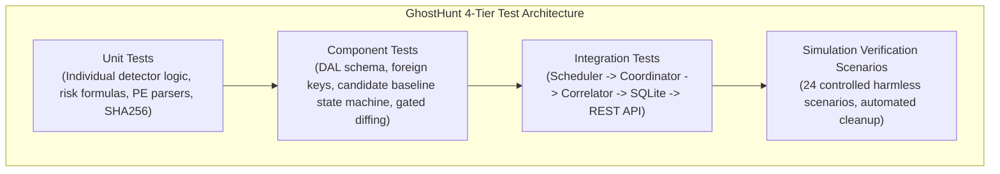

# GhostHunt — Automated Testing Strategy & Verification Guide

**Document Version:** 1.4.3  
**Target Platform:** Windows 10 / Windows 11 (x64)  
**Test Framework:** Standard Library `unittest` & `pytest`  
**Academic Context:** Senior Undergraduate Capstone Project  
**Date:** November 2026  

---

## 1. Automated Testing Pyramid

GhostHunt employs an exhaustive 4-tier automated testing strategy designed to verify mathematical invariants, operating system API bindings, concurrency locks, and end-to-end multi-signal detection capabilities.



---

## 2. Test Suite Organization & Inventory

The test suite consists of **27 test classes** spanning 17 test modules:

| Test Module Path | Focus Area & Capabilities Tested | Test Cases |
| :--- | :--- | :---: |
| `tests/test_db.py` | SQLite DAL, WAL mode, foreign keys, baseline states, atomic transactions, CHECK constraint | 19 |
| `tests/test_process_views.py` | 3-view enumeration, Toolhelp32, WMI COM/CIM, NT API, quorum, 50ms transient filter | 26 |
| `tests/test_process_view.py` | Re-exports Phase 2 process views test suite for backward compatibility | 26 (re-export) |
| `tests/test_persistence.py` | Registry 32/64-bit, Tasks, Services, candidate review, explicit acceptance, gated diffing | 10 |
| `tests/test_signature_check.py` | 16-combination 4×4 reconciliation matrix, Wintrust ctypes structures, hybrid cache, path anomaly | 20 |
| `tests/test_correlator.py` | Multi-signal risk formula, threat vs diagnostic score isolation, deduplication, dual-key mapping | 17 |
| `tests/test_scheduler.py` | Background scheduler daemon, in-process `threading.RLock()`, error recovery, interval pacing | 9 |
| `tests/test_scan_coordinator.py` | 9-step scan lifecycle, failure handling, atomic commit, scan status integrity | 7 |
| `tests/test_dashboard.py` | Flask web presentation templates, routes, latest completed scan querying | 8 |
| `tests/test_api.py` | REST API endpoints, HTTP 409 conflict, manual scan, baseline accept/reset, history | 16 |
| `tests/test_api_security.py` | CSRF enforcement, localhost binding, XSS auto-escaping, 1MB payload limits, secret suppression | 10 |
| `tests/test_simulation_cleanup.py` | `SimulationCleanupManager`, PID tracking, process termination, temp folder purging | 5 |
| `tests/test_process_scenarios.py` | Signal 1 simulation scenarios (PV-1 through PV-5) | 5 |
| `tests/test_persistence_scenarios.py`| Signal 2 simulation scenarios (PER-1 through PER-4) | 4 |
| `tests/test_signature_scenarios.py` | Signal 3 simulation scenarios (SIG-1 through SIG-5) | 5 |
| `tests/test_end_to_end_scenarios.py`| Multi-signal integration scenarios (Scenario A through J) | 10 |
| `tests/test_scenario_runner.py` | Scenario registry discovery, runner execution, CLI / REST API execution | 4 |
| `tests/test_config.py` | Configuration constants, risk weights sum to 1.0, cache TTL, threshold ordering | 4 |

---

## 3. Test-Count Accounting & Discrepancy Resolution

During test execution, `unittest` reports:
```text
Ran 261 tests in 20.506s
OK
```

### 3.1 Mathematical Decomposition
A rigorous audit of test discovery confirms the exact relationship between discovered executions, unique test classes, and physical test methods:

$$\begin{aligned}
\text{Total Discovered Executions} &= 261 \\
\text{Net Unique Test Methods} &= 235 \\
\text{Duplicate Executions} &= 26 \\
\text{Unique Bare Method Names} &= 234
\end{aligned}$$

### 3.2 Source of Duplicate Executions (26 Tests)
The 26 duplicate test executions arise entirely from `tests/test_process_view.py`. 
- During Phase 2, `tests/test_process_views.py` implemented the comprehensive 26-test suite `TestProcessViewsEngine`.
- In `tests/test_process_view.py`, the module provides:
  ```python
  from tests.test_process_views import TestProcessViewsEngine
  ```
- Because Python's `unittest` test discovery discovers tests by scanning all classes inheriting from `unittest.TestCase` in all modules matching `test_*.py`, `unittest` discovers `TestProcessViewsEngine` twice: once in `tests/test_process_views.py` and once in `tests/test_process_view.py`.
- Calculation: $235 \text{ (unique tests)} + 26 \text{ (duplicate executions)} = \mathbf{261 \text{ total executions}}$.

### 3.3 Explanation of Unique Method Names (234 Names)
When querying test method names without their class or module prefix:
- Two distinct test classes define an identically named test method: `test_re_exports_in_detector_module`.
  1. `tests.test_correlator.TestRiskCorrelationEngine.test_re_exports_in_detector_module` (verifies `detectors.correlator` re-exports).
  2. `tests.test_signature_check.TestSignatureStructuresAndImports.test_re_exports_in_detector_module` (verifies `detectors.signature_check` re-exports).
- These are two distinct physical test cases testing different modules, yielding $235 - 1 = \mathbf{234 \text{ unique method names}}$.

---

## 4. How to Execute Tests

### 4.1 Running the Full Regression Test Suite
Run from the repository root:
```powershell
python -m unittest discover -v -s tests -p "test_*.py"
```

### 4.2 Running Specific Test Modules
```powershell
# Run database schema & DAL tests
python -m unittest -v tests/test_db.py

# Run multi-signal correlator tests
python -m unittest -v tests/test_correlator.py

# Run REST API security tests
python -m unittest -v tests/test_api_security.py
```

### 4.3 Running the Complete Simulation Scenario Suite
To execute the 24 academic demonstration scenarios:
```powershell
python simulators/scenario_runner.py --all
```
Expected output:
```text
======================================================================
GhostHunt Phase 7: Executing Complete Simulation Scenario Suite
======================================================================
  [PASS] PER-1        Candidate Baseline Capture                 55.9ms
  [PASS] PER-2        Added Persistence Entry Deviation          64.9ms
  [PASS] PER-3        Modified Persistence Entry Deviation       59.7ms
  [PASS] PER-4        Persistence Enumeration Failure Isolation   61.0ms
  [PASS] PV-1         Consistent Process Enumeration             21.8ms
  [PASS] PV-2         Confirmed Process-View Discrepancy         70.2ms
  [PASS] PV-3         Transient Process Termination Filter       77.5ms
  [PASS] PV-4         Source Failure Isolation                   25.9ms
  [PASS] PV-5         Insufficient Source Quorum                 25.9ms
  [PASS] SCENARIO-A   Clean System Baseline                     105.2ms
  ...
======================================================================
Summary: 24/24 scenarios passed.
======================================================================
```

---

## 5. Mocking vs. Live Host Execution Patterns

To balance deterministic CI/CD verification with realistic Windows host validation, GhostHunt uses a hybrid testing strategy:
- **Mocked / Controlled Testing:** Engine tests (`test_process_views.py`, `test_persistence.py`, `test_signatures.py`) use dependency injection to simulate edge cases that are difficult or dangerous to induce on a live system (e.g. simulated WMI RPC server crashes, quorum drops, 4×4 signature matrix combinations, tampered PE headers).
- **Live Host Testing:** Tests such as `test_01_toolhelp32_live_enumeration` and `test_01_successful_scan_with_no_findings` query actual live Windows APIs, confirming that Win32 ctypes structures and OS bindings function seamlessly on the target Windows build.
- **Cleanup Guarantee:** All simulation scenarios use `SimulationCleanupManager` to ensure zero residual test processes or modified registry keys remain on the host after test execution.
