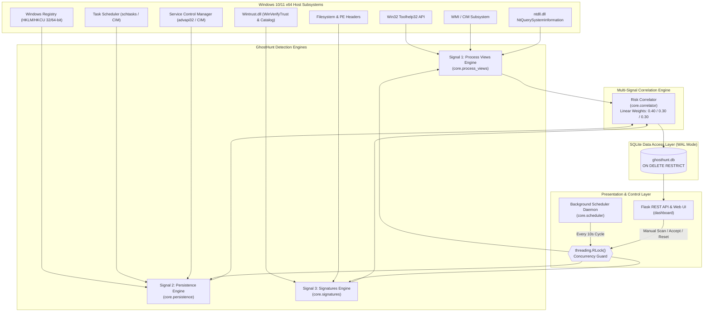
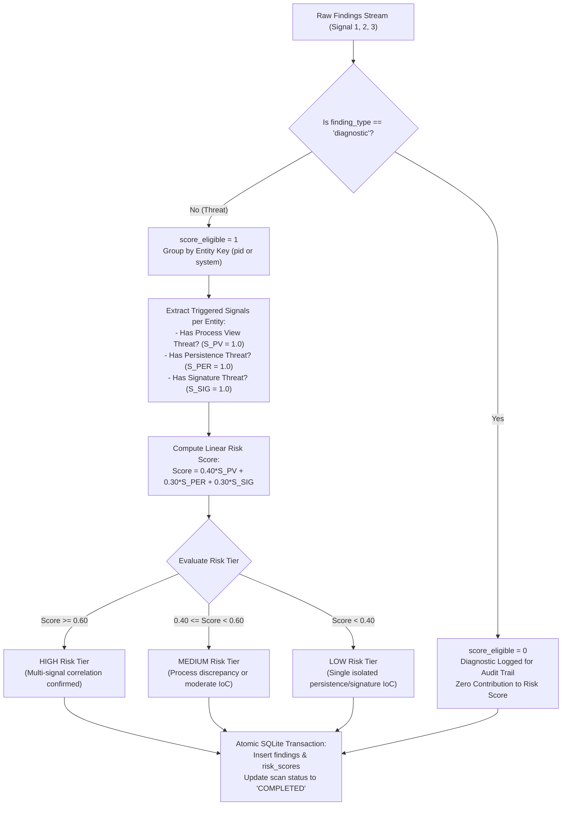
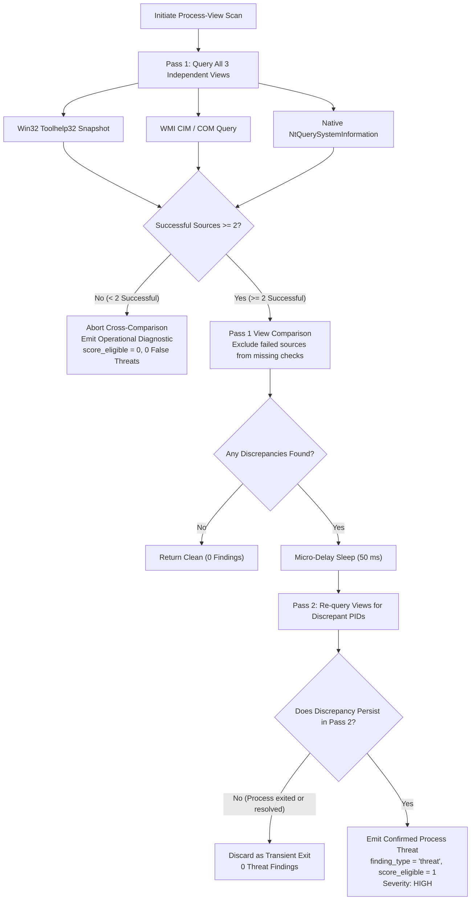
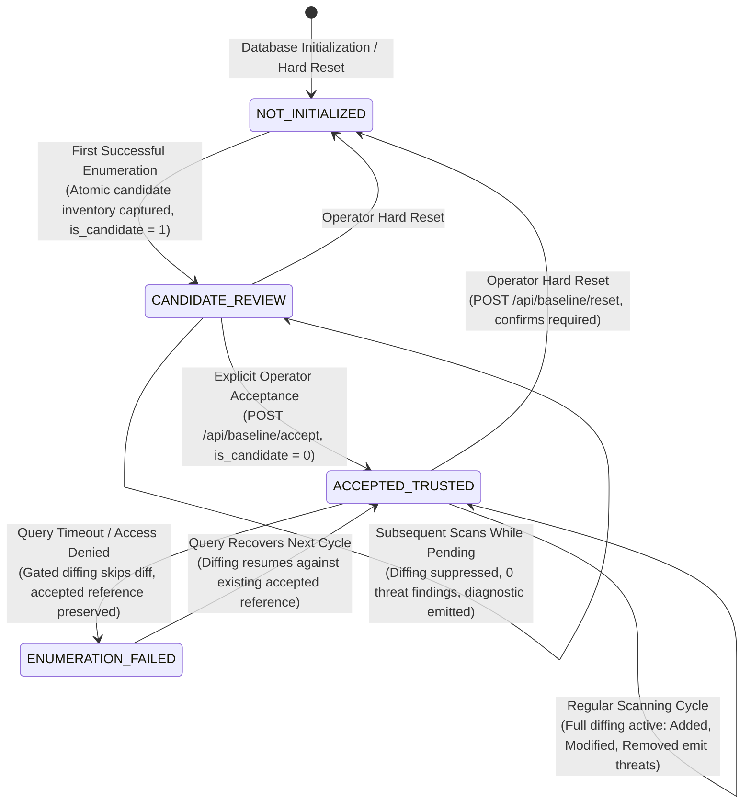
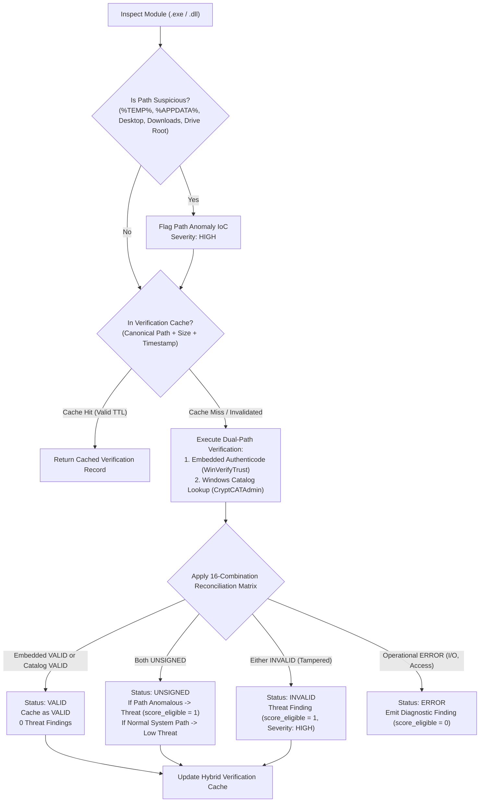

# GhostHunt — System Architecture & Security Analysis

**Document Version:** 1.4.3  
**Target Platform:** Windows 10 / Windows 11 (x64)  
**Architecture:** Python 3.10+ / Flask / SQLite WAL / Win32 User-Mode APIs  
**Academic Context:** Senior Undergraduate Capstone Project  
**Date:** November 2026  

---

## 1. System Overview

GhostHunt is a defensive, host-based stealth malware and user-mode rootkit detection system for Windows 10/11 x64. Unlike signature-only antivirus scanners or invasive kernel drivers, GhostHunt operates entirely in user-mode using a multi-signal behavioral anomaly architecture. It correlates independent indicators of compromise (IoCs) across three distinct defensive domains:

1. **Cross-View Process Enumeration (Signal 1 — Weight: 0.40):** Cross-compares active process tables across three distinct enumeration paths (Win32 Toolhelp32, WMI COM/PowerShell CIM, and Native NT API `NtQuerySystemInformation`) with quorum requirements and two-pass micro-delay confirmation to uncover hidden processes.
2. **Persistence Monitoring (Signal 2 — Weight: 0.30):** Monitors autostart execution points across 32-bit and 64-bit Registry Run/RunOnce keys, Scheduled Tasks, and Windows Services, evaluating deviations strictly against explicitly operator-reviewed and accepted reference baselines.
3. **Loaded Module Signature & Path Anomaly Verification (Signal 3 — Weight: 0.30):** Enforces Authenticode embedded signatures and Windows Security Catalog bindings via `Wintrust.dll` using a 16-combination reconciliation matrix, alongside filesystem path anomaly detection (%TEMP%, %APPDATA%, Desktop, Downloads, root directory).

Risk scores are computed through a linear multi-signal model:
$$\text{Score} = w_{\text{PV}} \cdot S_{\text{PV}} + w_{\text{PER}} \cdot S_{\text{PER}} + w_{\text{SIG}} \cdot S_{\text{SIG}} = 0.40 \cdot S_{\text{PV}} + 0.30 \cdot S_{\text{PER}} + 0.30 \cdot S_{\text{SIG}}$$

Entities scoring $\ge 0.60$ are classified as **HIGH** risk, $[0.40, 0.60)$ as **MEDIUM**, and $< 0.40$ as **LOW**.

---

## 2. High-Level Architecture & Data Flow

GhostHunt is architected as an integrated single-process application containing four modular subsystems:
- **`core/`**: Central Data Access Layer (`db.py`), Multi-Signal Risk Correlator (`correlator.py`), and In-Process Concurrency-Guarded Background Scheduler (`scheduler.py`).
- **`detectors/`**: Detector facades re-exporting underlying engines (`process_view.py`, `persistence.py`, `signature_check.py`).
- **`dashboard/`**: Flask web presentation layer and REST API (`routes.py`, Jinja2 templates, and responsive JavaScript).
- **`simulators/`**: Harmless academic simulation harness executing controlled validation scenarios with automated cleanup.



---

## 3. Detailed Component Architecture

### 3.1 Multi-Signal Correlation & Risk Scoring Flow

GhostHunt strictly isolates forensic threats from operational diagnostics. Operational diagnostics (e.g., query timeouts, permission limitations) are tagged `score_eligible = 0` and never contribute to entity risk scores. Threat findings (`score_eligible = 1`) contribute to the corresponding signal score component ($S_{\text{PV}}, S_{\text{PER}}, S_{\text{SIG}} \in \{0.0, 1.0\}$). Findings are deduplicated and mapped to active processes using a dual-key strategy (`pid:<PID>` if running, or `system:<category>:<name>` for dormant persistence entries).



### 3.2 Cross-View Process Enumeration Flow

The Process Views engine acquires process lists from three distinct system interfaces. To prevent false alarms caused by fast-exiting transient processes, any discrepancy detected in Pass 1 is re-evaluated after a 50 ms micro-delay (`MICRO_DELAY_SECONDS = 0.05`). A minimum quorum of $\ge 2$ operational sources is required; if fewer than 2 sources succeed, comparison is aborted and an operational diagnostic is emitted.



### 3.3 Persistence Baseline Lifecycle State Machine

GhostHunt treats baseline management as an explicit, auditable security ceremony. Systems are never assumed clean on first launch. The baseline state machine enforces that autostart entries discovered during uninitialized states are captured as candidate inventories requiring operator inspection and explicit cryptographic acceptance.



### 3.4 Dual-Path Signature Verification Matrix Flow

The Signature Verification engine subjects loaded executable modules to a dual-path verification process: WinVerifyTrust Authenticode checking and Windows Security Catalog checking. Results are reconciled through an exhaustive 4×4 decision matrix ensuring operational errors never convert into unsigned verdicts.



---

## 4. Security Model & Defensive Invariants

### 4.1 Strict Diagnostic-Threat Isolation Invariant
GhostHunt guarantees that administrative, environment, and communication failures never trigger false malware alerts.
$$\forall f \in \text{findings}: \left( f.\text{finding\_type} = \text{'diagnostic'} \implies f.\text{score\_eligible} = 0 \right)$$
This invariant is enforced at three independent layers:
1. **Engine Level:** Detectors assign `finding_type` and `score_eligible` explicitly.
2. **Data Access Layer Level:** `db.validate_finding()` rejects contradictory inputs before executing SQL.
3. **Database Schema Level:** SQLite table definition includes a table-level CHECK constraint:
   ```sql
   CONSTRAINT chk_diagnostic_invariants CHECK (
       (finding_type = 'diagnostic' AND score_eligible = 0) OR
       (finding_type = 'threat' AND score_eligible IN (0, 1))
   )
   ```

### 4.2 In-Process Concurrency & Re-Entrancy Control
The application operates within a single Python process protected by a global re-entrant synchronization primitive (`threading.RLock()`). 
- Scheduled scans, manual scans (`POST /api/scan`), baseline acceptances (`POST /api/baseline/accept`), and baseline resets (`POST /api/baseline/reset`) compete for the shared operation lock.
- If an operation is already executing, concurrent requests immediately return **HTTP 409 Conflict** with an informative JSON payload (`{"status": "busy", "message": "Operation already in progress"}`).
- The Flask presentation server is explicitly deployed with `debug=False` and `use_reloader=False` to prevent duplicate worker forks or lock bypasses.

### 4.3 SQLite WAL Mode & Historical Forensic Immutability
- SQLite is configured with **Write-Ahead Logging (WAL)** (`PRAGMA journal_mode = WAL;`) and synchronous normal mode (`PRAGMA synchronous = NORMAL;`), allowing concurrent read operations without blocking scan writes.
- Foreign keys are enforced strictly (`PRAGMA foreign_keys = ON;`). Child tables (`findings`, `risk_scores`) define `ON DELETE RESTRICT` constraints referencing `scans(id)`.
- Scans and findings are strictly append-only. Automated pruning or cascading deletions are architecturally prohibited to preserve forensic non-repudiation.
